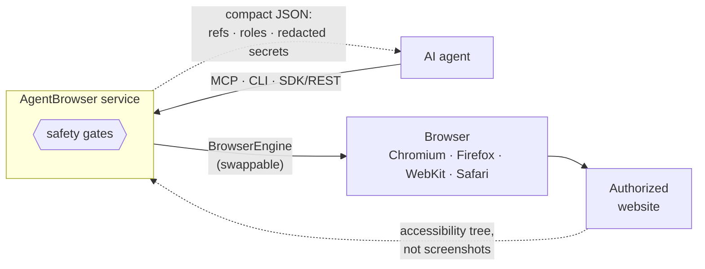
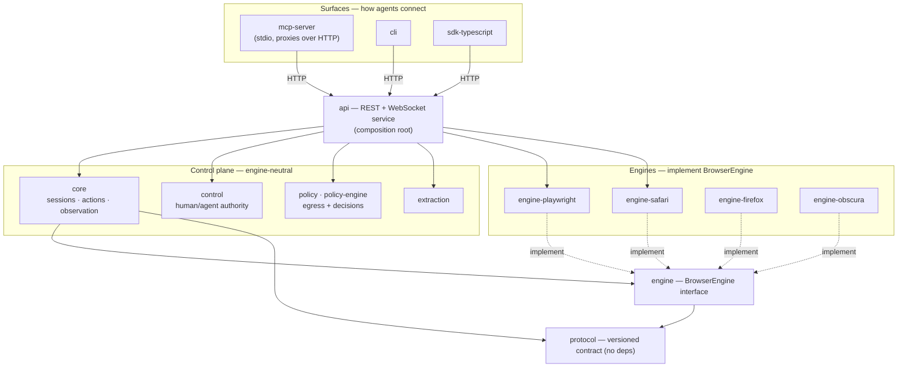
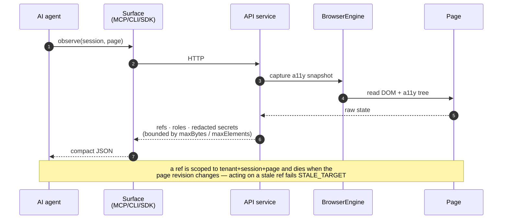
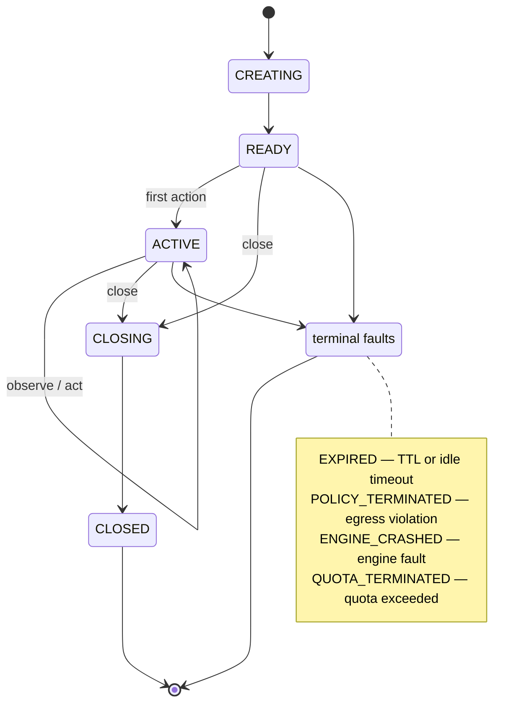
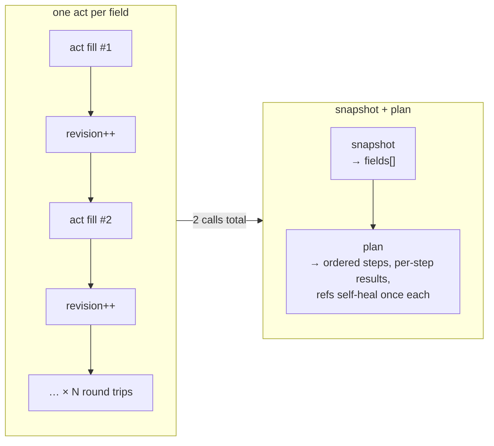

# AgentBrowser: Agent-First Browser Automation

[](https://github.com/anvai-labs/agentbrowser/actions/workflows/ci.yml)


AgentBrowser lets AI agents safely and reliably operate **authorized** websites through a compact, deterministic interface: semantic observations instead of screenshots, stable element references with staleness detection, egress policy enforcement, and approval gates for side effects.

The opt-in [delegated-session workflow](docs/delegated-sessions.md) adds a human control
panel, revocable session tokens, and operation reconciliation for cooperating agent
harnesses.

[](https://youtu.be/1ZEtWKqpxQI)

## How it works, at a glance

An agent connects through one of three surfaces; the service does the driving and
hands back **semantic observations**, never pixels. Every outbound request and
every side effect pass through a safety gate on the way.



The four safety invariants, in one line each:

| Guarantee | What it means for the agent |
| --- | --- |
| **Semantic observations** | You read an accessibility/DOM model, not a screenshot — smaller, deterministic, diffable. |
| **Stable element refs** | You act on `e<rev>_<n>` handles that **expire when the page changes**, so you can never click a stale target. |
| **Egress policy** | Loopback, private IPs and cloud metadata are blocked by default (SSRF defense) at a single choke point. |
| **Approval gates** | Transactions and account changes need a single-use token before they run. |

## Install (Homebrew)

```bash
brew install anvai-labs/tap/agentbrowser
brew services start anvai-labs/tap/agentbrowser   # the service, on 127.0.0.1:5709
```

One install ships all three surfaces: the **browser service**, the standalone
**CLI** (`agentbrowser`) and the optional **MCP adapter** (`agentbrowser-mcp`).
The first service start bootstraps Chromium into
`$(brew --prefix)/var/agentbrowser/browsers`. The compiled CLI and MCP binaries
need no Node runtime. Without Homebrew, use the
`agentbrowser-cli-<target>` and `agentbrowser-mcp-<target>` client assets for
macOS, Linux or Windows. Service archives are published for macOS and Linux as
`agentbrowser-server-<target>.tar.gz`; they require Node 22 or newer and separately
provisioned Chromium (plus its platform libraries on Linux). See the
[operations guide](docs/operations.md#release-assets) for deployment details.

## Install (Windows)

```powershell
# once the package is accepted into winget-pkgs (not yet published):
winget install AnvaiLabs.AgentBrowser
agentbrowser-server                     # first start downloads Chromium (~300 MB)
# or extract agentbrowser-windows-x64.zip from v1.17.1 or later and run .\agentbrowser-server.exe
```

The zip is self-contained: the service runs on its own bundled Node.js runtime, and
`agentbrowser-cli` and `agentbrowser-mcp` are standalone executables. Nothing is registered as a
Windows service; see [Windows in the operations guide](docs/operations.md#windows-install). On
Windows the CLI command is `agentbrowser-cli`.
npm carries only the MCP adapter (`@anvailabs/agentbrowser-mcp`), not the service.

### Consuming directly from a shell

The CLI is the smallest universal agent interface. It connects directly to the
HTTP service, emits structured JSON matching the service contracts and can
describe one command at a time without contacting the service:

```bash
agentbrowser describe
agentbrowser describe autofill --schema
agentbrowser describe outcome --schema
agentbrowser --base-url http://localhost:5709 --json health
```

For a local deployment, install the service and CLI; for a remote deployment,
only the CLI is required on the agent host. MCP is optional in both cases. See
[the shell-agent CLI guide](docs/cli-agent-usage.md) for bounded JSON input,
operation reconciliation and bulk plan/autofill/outcome examples.

AgentBrowser 1.9.0 includes receipt-correlated `outcome` verification for deployments
that register an exact verifier and trusted evidence source. The controlled
qualification establishes G4 evidence, not a production application commit or G6
independence; see the CLI guide for the authority and evidence boundaries.

### Consuming as an MCP server

`agentbrowser-mcp` speaks newline-delimited JSON-RPC over stdio (MCP 2024-11-05):

- **Claude Code**: `claude mcp add agentbrowser -- $(brew --prefix)/opt/agentbrowser/bin/agentbrowser-mcp`
- **Claude Desktop** (`claude_desktop_config.json`):
  ```json
  {"mcpServers": {"agentbrowser": {"command": "/opt/homebrew/opt/agentbrowser/bin/agentbrowser-mcp"}}}
  ```
- **Codex** (`~/.codex/config.toml`):
  ```toml
  [mcp_servers.agentbrowser]
  command = "/opt/homebrew/opt/agentbrowser/bin/agentbrowser-mcp"
  ```
- **Victor** (`~/.victor/mcp.yaml`): `command: /opt/homebrew/opt/agentbrowser/bin/agentbrowser-mcp`

Tool calls drive the **AgentBrowser service** (default `http://localhost:5709`;
override with `AGENTBROWSER_BASE_URL`, authenticate with `AGENTBROWSER_API_KEY`).

## Engines

Engine-neutral by contract ([ADR-002](docs/adr/002-engine-neutral-protocol.md)); every engine passes the same [contract suite](packages/testkit). See the [engine matrix](docs/engines.md).

| Engine | Status | Notes |
| --- | --- | --- |
| Chromium (Playwright) | Production default | Partial routing enforcement; redirect/DNS limitations in the [engine matrix](docs/engines.md) |
| Chromium (remote CDP) | Supported | `cdpEndpoint` engine option |
| Firefox / WebKit (Playwright) | Supported | Same contract suite |
| **Real Safari (safaridriver)** | **Direct-engine local use only** ([TD-BROWSER-7](docs/td/TD-BROWSER-7-safari-webdriver-engine.md), [ADR-011](docs/adr/011-safari-via-safaridriver-webdriver.md)) | macOS only, always headed; guarded REST creation unsupported because egress is not enforceable |
| Obscura (Rust) | Experimental, benchmark-only | |

### Headed sessions and credential handoff

Real-login flows (Keychain, device-trust SSO) are first-class
([TD-BROWSER-6](docs/td/TD-BROWSER-6-headed-sessions-and-credential-handoff.md)):
create a session with `headless: false` — the engine launches a dedicated
headed browser owned by that session, so interactive crashes never touch the
headless pool. Cookies export/import (httpOnly included) closes the loop: log
in once by hand, export, seed future headless sessions via the create
request's `cookies` option.

Engines that cannot run headless (Safari) declare `alwaysHeaded`; the service
rejects explicit `headless: true` for them loudly
(`SAFARI_HEADLESS_UNSUPPORTED`) instead of silently running headed.

**Passkey/WebAuthn ceremonies need operator attach, not spawned sessions.**
Service-spawned browsers (headed or headless) cannot use the platform
authenticator — Touch ID/Windows Hello refuses them instantly
(`NotAllowedError`). Attach to the operator Chrome instead:
[ADR-034](docs/adr/034-cross-machine-operator-attach.md) documents the
cross-machine topology (daemon on the Chrome host, agent drives it over an
authenticated forwarded port).

## Branching & releases

**`develop` is the integration branch** — feature PRs target `develop`
(CI-gated). Promotion is explicit: `develop` → `main` via a release PR
(CI-gated), releases are tagged on `main`. Docs-only changes skip CI
(`paths-ignore`) — prose cannot burn compute.

## Architecture

TypeScript control plane (Node 24.21.0 qualification/build baseline, pnpm
workspace) over an engine-neutral protocol. The dashed line is the one that
matters: **everything above it is engine-agnostic**, and every engine below it
implements the same `BrowserEngine` interface and passes the same contract
suite, so engines swap without touching clients ([ADR-002](docs/adr/002-engine-neutral-protocol.md)).



*Edges show the primary layering, not every dependency: `protocol` (and, to a
lesser degree, `engine`) underpins most packages — including `api` directly — so
those contract edges are drawn once at the spine rather than from every node. The
authoritative graph is each package's `package.json`.*

<!-- Keep this table in sync with packages/*/package.json descriptions. -->

| Package | Layer | Role |
| --- | --- | --- |
| `protocol` | contract | Versioned schemas + types; the public contract (zero deps). |
| `engine` | contract | The `BrowserEngine` interface + engine-neutral types. |
| `core` | control | Session coordination, action execution, observation normalization. |
| `control` | control | Shared human/agent authority; browser-independent application operations. |
| `policy` | control | Network egress policy (SSRF defense). |
| `policy-engine` | control | Server policy decisions behind one Authorizer seam ([ADR-024](docs/adr/024-server-policy-engine-cedar.md)). |
| `extraction` | control | Deterministic page extractors with evidence provenance. |
| `engine-playwright` | engine | Chromium / Firefox / WebKit (production default). |
| `engine-safari` | engine | Real Safari via safaridriver (macOS, always headed). |
| `engine-firefox` | engine | Experimental native Firefox WebDriver BiDi (trusted local). |
| `engine-obscura` | engine | Experimental Rust engine adapter (benchmark-only). |
| `api` | surface | REST + WebSocket service; the composition root. |
| `cli` | surface | Human + shell-agent CLI; offline command discovery. |
| `mcp-server` | surface | MCP stdio adapter; talks to the service over HTTP. |
| `sdk-typescript` | surface | TypeScript client SDK. |
| `testkit` | support | `FakeEngine` + the reusable contract suite. |
| `engagement` | support | Findings bound to an engagement ledger; SARIF draft export. |
| `audit` | support | Visual audit adapter (baseline/versioned pixel diffs). |
| `benchmarks` | support | Benchmark harness, deterministic task suite, soak tests. |

The unbound MCP catalog exposes twenty-five tools, among them `session_create`,
`page_create`, `navigate`, `observe`, `act`, `autofill`, `plan`, `extract`,
`screenshot`, `pdf`, `events_replay`, `policy`, `scope` — and `page_fetch`, the
scoped origin-context API probe: one authenticated method+URL+body request
issued from the live page's own origin (its cookie jar and CSRF headers apply)
through the session's engagement scope, with unsafe methods gated by a one-use
approval token (ADR-030). Delegated mode exposes twenty tools under operator
control. The complete, versioned catalog is in
[docs/mcp-tool-catalog.md](docs/mcp-tool-catalog.md). No raw
selectors, no evaluate - element refs come from observations and die with their
revision (ADR-009). Observed values are redacted at the engine's sensitivity
boundary (TD-BROWSER-13): password and credential fields report
`valueRedacted: true` instead of a value.

### A round trip

Reads and actions follow the same path. The engine captures an accessibility
snapshot; the service redacts, bounds and normalizes it into compact JSON before
the agent ever sees it.



### Session lifecycle

Sessions are **ephemeral by default** — a TTL and an idle timeout reap them, and
any policy or engine fault moves them to a terminal state instead of hanging
([ADR-005](docs/adr/005-ephemeral-sessions-explicit-persistence.md)).



### The fast path for forms: snapshot then plan

For supported native forms, prefer [scoped bulk autofill](docs/bulk-autofill.md):
send structured fields once through CLI `autofill`, REST/SDK or `browser_autofill`; the server
resolves and verifies them with per-field receipts. Custom widgets remain qualified
separately.

For explicit heterogeneous steps, the snapshot/plan pair remains available:

Filling a multi-field form one `browser_act` at a time costs a round trip
per field, because every action bumps the page revision. The batched pair
collapses that to two calls ([TD-BROWSER-8](docs/td/TD-BROWSER-8-batched-snapshots-and-action-plans.md)):




1. `browser_snapshot` returns a self-contained page summary - url, title,
   revision, the page's adaptive `mode`, and `fields` (`{ref, role, label}`).
2. `browser_plan` executes the whole ordered sequence (fill/click/press/
   scroll) in one call, reporting per-step results. A stale ref self-heals
   once per step; once a page has churned enough to enter `verified` mode,
   the executor requires a role+label match before remapping and aborts
   loudly (`AMBIGUOUS_REMAP`) rather than risk acting on the wrong element.

### Shell and CLI agents

Use `agentbrowser --help` for server/client environment settings and a LAN setup
example. Command help and offline `describe` share usage notes and examples:
`agentbrowser session create --help`, `agentbrowser session cookies --help`, and
`agentbrowser describe navigate`. See the [CLI quick reference](docs/cli-agent-usage.md#find-the-answer-in-cli-help-first)
before inspecting source. Help describes the installed client, not the live server.

Use `agentbrowser describe` to discover immediate commands as JSON without a running
service, then `agentbrowser describe act press` to load only one command's details.
Execution uses the existing SDK/service: pass `--json`, quote shell arguments and
inspect outcomes rather than relying on exit code alone. See the
[CLI agent guide](docs/cli-agent-usage.md) for Bash/jq examples and reconciliation.
Offline `test evaluate` (shipped in 1.10.1) produces caller-observed case
reports; it reuses the bound test contract and needs no service or MCP
connection.

## Development

```bash
pnpm install          # Node 24.21.0, pnpm 9.15
pnpm -r build && pnpm -r type-check
pnpm -r test          # unit + contract; Safari tests self-gate on macOS
pnpm lint             # Biome and lint-policy regression probes
```

## Documentation

New here? Read top to bottom: the README above covers install and the MCP
surface; the rest depends on who you are.

**Using AgentBrowser**

- [CLI and shell agents](docs/cli-agent-usage.md) - offline command discovery, JSON output and safe reconciliation
- [Consuming as an MCP server](#consuming-as-an-mcp-server) - Claude Code, Claude Desktop, Codex, Victor wiring
- [Snapshot then plan](#the-fast-path-for-forms-snapshot-then-plan) - the two-call form-filling flow
- [Interactive forms recipe](docs/recipes/interactive-forms.md) - custom comboboxes, async menus, sectioned plans, verifying what got selected
- [TypeScript SDK](packages/sdk-typescript) - programmatic clients (`SessionsClient.plan` / `.snapshot`)
- REST: every route is documented by the service itself at `GET /openapi.json`

**Running AgentBrowser**

- [Operations guide](docs/operations.md) - configuration, auth, health and metrics, session lifecycle, deployment, troubleshooting
- [Engine matrix](docs/engines.md) - engines, their contract-suite status, and egress guarantees
- [Changelog](CHANGELOG.md) - what changed in each release

**Understanding the design**

- [Docs index](docs/README.md) - the full map: ADRs (the "why"), threat model, audits
- [Architecture decisions](docs/README.md#architecture-decision-records-adrs) - ADR-001…021
- [Technical designs](docs/td/) - TD-BROWSER-5…13 feature records
- [Threat model](docs/threat-model.md) - the security posture and its named limits
- [Human handoff](docs/human-handoff.md) - working a session with a person in the loop: approval gates, headed credential entry, re-observe discipline
- [Delegated sessions](docs/delegated-sessions.md) - human takeover, revocable agent credentials, and regression checks
- [Synthetic input limitations](docs/synthetic-input-limitations.md) - browser input trust, application acceptance, and independent outcome checks

## License

Apache-2.0

## Inspired By

- [Cloudflare Kitesurf](https://blog.cloudflare.com/kitesurf/) - stateless browser architecture
- [Playwright](https://playwright.dev/) - browser automation foundation
- [Obscura](https://github.com/h4ckf0r0day/obscura) - Rust headless engine reference

### Compact capture output

CLI screenshot, PDF, HTML and artifact retrieval save private files by default in
`~/.abrowser/artifacts`, returning small receipts. MCP defaults to artifact references;
image/PDF content requires `inline:true`, and the `artifact` tool supports bounded
retrieval. Set `AGENTBROWSER_ARTIFACT_DIR` for an explicit cache location. See
[cache limits, cleanup and inline options](docs/cli-agent-usage.md#consumer-recovery-and-bounded-output).

## Contributing

Issues and PRs welcome — see [CONTRIBUTING.md](CONTRIBUTING.md). First-time
contributors sign a lightweight [CLA](.github/CLA.md) by checking a box in the PR
template.
