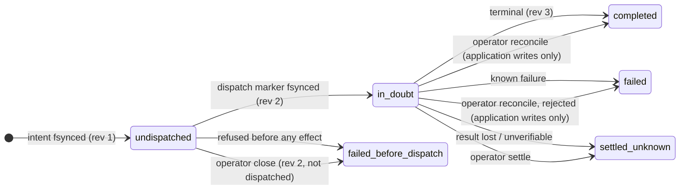

# Operating AgentBrowser

A practical guide to running the AgentBrowser service: installation,
configuration, health and metrics, day-to-day operation, and
troubleshooting. For what AgentBrowser is and how to drive it as a
client, start with the [README](../README.md); for the security model,
see the [threat model](threat-model.md) and the
[safety ADRs](https://github.com/anvai-labs/agentbrowser#core-architecture-adrs).

## Operator approval policy

`AGENTBROWSER_APPROVAL_POLICY` accepts a JSON object, or embedders can pass
`ServerOptions.approvalPolicy`. Rules use exact hostname/action/role/name matches;
the first matching rule wins. They are trusted deployment configuration, not
instructions accepted from the page or from an agent request. For example:

```json
{"unknownRisk":"required","rules":[{"hostname":"shop.example","action":"click","name":"Pay","effect":"transaction"}]}
```

A rule may carry an optional `id`, which names it as the deciding rule
(`env.approval.<id>`). An id is 1-64 lowercase letters, digits, `.`, `_` or `-`, is
unique, and is not `none` or `rule-<n>`, which name unmatched and unnamed rules. An
invalid id stops the service at startup, naming the rule.

Unknown-risk actions default to `allow` for local automation; select `required`
for conservative operation. Recognized high-risk effects require confirmation
unless an operator rule explicitly allows or denies them. Session
`policy.approval.transactions` and `externalMessages` can tighten a decision to
`required` or `deny`, but cannot relax the operator policy. Rules do not infer
transaction semantics from arbitrary page text; audit them for your workflows.

On `APPROVAL_REQUIRED`, clients must obtain operator confirmation before retrying
with `details.tokenId` as `approvalToken`. The token is single-use and bound to
page, revision, resolved target fingerprint and action parameters. This protocol
records caller confirmation; it does not independently authenticate a human.
Stale targets must be reobserved and require new confirmation.

For explicit operator decisions, create an authenticated controlled session with
`policy.approval.review: "operator"` (CLI: `session create --delegated --reviewed-approval`).
This changes actions requiring approval; allowed actions remain allowed and policy
denials still win. Pending-token echo cannot authorize a reviewed action. The
operator must stay in human control for inspection, decision and execution.

After an action reports `APPROVAL_REQUIRED`, use its token ID:

```bash
agentbrowser --json session approval "$SESSION" "$TOKEN"
agentbrowser --operation-id decision-1 session approval-decide "$SESSION" "$TOKEN" --decision approve
agentbrowser --operation-id execution-1 act --approval-token "$TOKEN" click "$SESSION" "$PAGE" "$REF"
```

`--json` inspection contains private action parameters; text output shows only
token/status. Inspect before deciding. Use `--decision deny` to refuse a pending
challenge or revoke an approved one. Used/denied/expired tokens cannot reapprove.
Takeover, configuration changes and handoff invalidate old authority context;
page/action drift is rechecked on execution. Inspection reports stored lifecycle
state, not a guarantee that the page still matches or execution will succeed.

Decision and execution use distinct operation IDs. After response loss, inspect
`session operation` and current approval state; do not replay an uncertain action
with a fresh ID. SDK replay reports `OPERATION_RECORDED`. Records are bounded and
ephemeral; missing or stale records convey no permission.

Vault references and actions containing registered secret data refuse reviewed
approval. The review covers an action, not complete form answers, file bytes or
the resulting network payload. This does not qualify application submission.
Operator API keys confer operator authority even when held by software; keep them
outside delegated harnesses. MCP is not required. See the
[C1 design](spec/design/t6-operator-approval.md) for the bounded contract.

### Reviewed application submission (develop candidate)

For a trusted application embedding, discovery can declare a write operation with
`review: "operator-submit"`. Its complete-payload review uses the same approval
owner and execution authority. The host must configure an application adapter and
an evidence-review provider that independently reconstructs the intended action;
the default service does not register a submit operation or a production ATS source.

The trusted host callback is `evidenceReviewProvider(request, context)`. Its frozen
`context.nativeForm` is the existing admission-scoped native reader: use
`context.nativeForm.read(signal)` inside the returned source's collector. It stays
valid after provider return within that admission, but cannot be reused in a later
request. Each review/inspection/decision/consumption gets a fresh context. Source
permission and application witness qualification remain required; the reader exposes
no service, browser page, cookies or execution authority. Existing one-argument
providers remain compatible. See the [embedding packet](spec/design/t4-production-evidence-composition.md)
for lifecycle and production configuration gates.

Create a controlled session with reviewed approval and retain operator control.
Prepare a private `review.json` containing `pageId`, a host-supplied `source` hint
(`ownerId` and `contract: {id, version}`), and `request` with the planned `operation`,
complete `input`, future `operationId` and `expectedVersion`. Discover the exact
wire shape with `agentbrowser describe application review --schema`.

```bash
agentbrowser application review "$SESSION" @review.json
agentbrowser --json session approval "$SESSION" "$TOKEN"
agentbrowser --operation-id decision-1 session approval-decide "$SESSION" "$TOKEN" --decision approve
agentbrowser --operation-id submit-1 application execute "$SESSION" submit @input.json --expected-version 2 --approval-token "$TOKEN"
agentbrowser --json application receipt "$SESSION" submit-1
```

Use the exact operation ID, version and input reviewed in `review.json`; `input.json`
contains only that request's input. Review creation also accepts stdin (`-`) through
the common bounded JSON reader. Text output contains token/status only; explicit
JSON inspection contains private answers and attachment metadata. Creation does not
approve, dispatch, or reserve the future execution ID. It rejects global
`--operation-id` because allocation is not idempotent: a lost creation response may
leave a pending token until expiry, and an explicit new review creates a new token.

Inspection, decision and execution recheck current owners and evidence permission.
Changed answers, hidden values or file identity refuse the old consent. Execution
reuses the original operation ID for status-only replay. A lost execution response
remains unknown; a fresh authorized receipt can supply separate reconciliation
evidence without repeating the submission. The named accepted-receipt verifier is
currently qualified in the synthetic fixture, not installed as a general ATS verifier.
See the [C3c design](spec/design/t6-public-application-review.md) and
[qualification evidence](spec/evidence/t6-public-application-review.md).

### Durable operations and recovery (T5)

**At a glance.** Opt-in per call; classification and recovery, never replay.



| What | Application write | Browser `act` / `plan` / `autofill` |
| --- | --- | --- |
| Opt in | `executionRequirement: "durable"` on execute | same field; CLI `--execution-requirement durable`; MCP `executionRequirement` |
| Needs | open journal | open journal + controlled (delegated) session + operation ID |
| Records | one per write | one per call, however many clicks |
| Rechecked after the storage wait | authorization + binding; reviewed writes also review currency, consent and pins | target ref + approval (consumed only after the recheck) |
| `close` / `settle` (operator key, REST) | ✔ / ✔ | ✔ / ✔ |
| `reconcile` | ✔ when the adapter implements it | ✖ always refused |
| Replay or resume | never | never |
| Receipt contents journaled | no | no (form values never stored) |

| Read | Who | How |
| --- | --- | --- |
| Health, horizons, history namespaces | operator or tenant API key | `GET /v1/journal` · CLI `journal status` |
| An operation's records + classification | operator or tenant API key | `GET /v1/journal/operations/{id}` · CLI `journal operations <id>` |
| `close` · `settle` · `reconcile` | operator key only | `POST /v1/journal/operations/{id}/{close\|settle\|reconcile}` |

Details below. Design: [recovery](spec/design/t5-recovery-design.md) ·
[browser durability](spec/design/t5-browser-durability.md); evidence:
[journal runtime](spec/evidence/t5-journal-runtime.md).

#### Durable application writes (T5 C4b)

With the `AGENTBROWSER_JOURNAL_*` variables configured (see [Configuration](#configuration)),
an application write that requests `executionRequirement: "durable"` is journaled in the qualified
SQLite store: the intent is committed before the effect, then a dispatch marker and a terminal
record, under a keyed fingerprint that never collides with an ephemeral one. Ephemeral writes
(the default) are unchanged and never touch the journal.

- **Advertised only while true.** Discovery lists `durable` in `writeExecution.supportedRequirements`
  only while the journal is open and still accepting; otherwise `durable` is refused with
  `CONTROL_REQUIRED` before anything executes. There is no ephemeral fallback.
- **Startup is all or nothing.** A partial configuration, an unreadable or group-readable key
  file, an uninitialized store without `AGENTBROWSER_JOURNAL_INITIALIZE=1`, a layout the store
  refuses, or a second server on the same store aborts startup. The journal needs Node 22.13 or
  later. One exception: once `AGENTBROWSER_JOURNAL_ACCEPT_UNTIL` has passed, the server starts
  **without** the journal and warns, rather than taking the whole service down. Durable is then
  neither advertised nor accepted until you configure a new namespace.
- **Shutdown drains.** With the journal configured, a graceful stop refuses new durable work and
  waits up to 30 seconds for in-flight durable operations to write their terminal records before
  the journal closes. Other operations, and deployments without a journal, shut down as before. A crash or kill
  leaves an in-flight durable write in doubt (`outcome_unknown`). That record stays in the
  namespace and keeps it from retiring until it is settled or reconciled (see
  [recovery](spec/design/t5-recovery-design.md)).
- **One namespace, stable across restarts.** Every start reopens the configured namespace. It
  accepts new durable writes until `AGENTBROWSER_JOURNAL_ACCEPT_UNTIL`, after which durable stops
  being advertised, and it keeps its records 30 days beyond that. It holds at most
  `AGENTBROWSER_JOURNAL_MAX_RECORDS` durable writes over its lifetime (a total, not a concurrency
  limit), and a store holds at most 64 namespaces.
  Full means refused, never evicted. Durable **browser** operations (`act`, `plan` or `autofill`
  sent with `executionRequirement: 'durable'`, journaled for classification only) use the same
  capacity: the agent opts in per call, there is no operator switch to refuse it, one tenant's
  durable browser traffic can use up what every tenant's durable application writes also need,
  and each `APPROVAL_REQUIRED` round trip costs one record. Its key, horizon, restore generation and capacity are
  immutable: rotate by configuring a new namespace name.
- **Reading and recovering records.** `GET /v1/journal/operations/{operationId}` (operator key or
  a tenant API key, read-only) lists an operation's records with a classification;
  `GET /v1/journal` reports health and horizons. With the operator key only, `close` ends
  never-dispatched records, `settle` ends in-doubt ones as unknown (irreversible), and
  `reconcile` asks an adapter that implements it what truly happened. Nothing is ever replayed.
- **After the horizon passes.** A namespace whose `ACCEPT_UNTIL` has passed no longer takes
  durable writes, but the server still opens it **recover-only** at startup: its records stay
  readable by lookup and recoverable by the operator until `retainUntil`.
- **Rotating with history (D7).** Once the old namespace's `ACCEPT_UNTIL` has passed, configure the
  next namespace and list the old one in `AGENTBROWSER_JOURNAL_HISTORY_FILE`, an owner-only
  (`0600`) JSON file. An entry listed before its horizon passes is reported and NOT opened (the
  store would otherwise create a missing namespace, so a typo could take a slot):

  ```json
  {
    "schemaVersion": 1,
    "namespaces": [
      {
        "namespace": "agentbrowser",
        "acceptUntil": "2027-01-01T00:00:00.000Z",
        "keyFile": "/etc/agentbrowser/journal-2026.key",
        "restoreGeneration": "generation-1",
        "maxRecords": 10000,
        "retainMs": 2592000000,
        "finalizationMs": 60000,
        "bounds": { "maxRecordBytes": 16384, "maxNamespaces": 64, "maxInFlight": 8, "timeoutMs": 5000 }
      }
    ]
  }
  ```

  Every value is the old namespace's ORIGINAL descriptor input (the `retainMs`, `finalizationMs`
  and `bounds` above are this release's constants; record them when the namespace is created, do
  not re-read them from a later release), and `keyFile` is the ORIGINAL key file: keep it, owner
  only, until the namespace's retention ends. History namespaces open on the same store, are
  searched by lookup and recoverable by the operator, and never take new writes. A wrong entry is
  reported in `GET /v1/journal` (`history[].state: "refused"`) and makes lookups report the
  namespace in `unreadNamespaces` — unread, never absent — without affecting the current
  namespace. **Deadline:** after `retainUntil` (30 days past the old `ACCEPT_UNTIL`) the store
  refuses every write to it, so close, reconcile or settle its open records before then; the
  server warns at startup within 7 days of it. Remove an entry once it is past `retainUntil`:
  the store no longer opens it, so it would read as unread forever. An open record left at
  `retainUntil` keeps one of the store's 64 slots forever (a recorded residual). Counting open
  records per history namespace is not yet offered. The CLI's `journal status` lists history
  namespaces and `journal operations` names unread ones.

## Installation

### Release version consistency

Root `package.json` owns the product version. When preparing a release, change
that version once, run `pnpm release:sync`, and commit the synchronized manifests
and generated stamps together. `pnpm release:check` is read-only; after building,
`pnpm release:artifacts` exercises API health, CLI `--version`, and MCP initialize.
CI rejects drift and release tags must equal `v<product-version>`. Matching package
versions identify one shipped product; they do not claim every package changed.

| Release gate (R14) | What it means for the person releasing |
| --- | --- |
| Tag on `main` | tag the promotion merge commit; `tag-guard` refuses a commit not reachable from `main` |
| `release tags` ruleset | only a repository admin can create, move or delete a `v*` tag |
| `npm` environment | the npm publish job pauses for the owner's approval (Review deployments; an admin can bypass); deploys only from a `v*` tag |
| Draft, then publish | the Release is filled as a draft and published once every asset is uploaded |
| Provenance | every asset has a signed build-provenance attestation: `gh attestation verify <file> -R anvai-labs/agentbrowser` |
| Immutable releases (switched on before 1.20.0) | once published, assets and the tag cannot be changed; a bad release gets a new version |
| Rerun after a failed publish | a partial draft is never overwritten. Upload failed: delete the draft, then rerun. Only the final publish failed: publish the draft by hand and **do not rerun** (the upload would refuse existing assets); winget never ran, so generate its manifests with `node scripts/winget-manifests.mjs --version <x.y.z> --zip-sha256 <hash>` and submit them |

### Upgrading from 1.8.4 to the 1.8.5 candidate

The owner retained the 1.8.5 release label after compatibility review. This is
an explicit versioning exception, not a claim of a bug-fix-only SemVer patch:
page listing adds a public REST endpoint, and custom-policy embeddings have a
migration requirement. The packages' private npm status does not establish that
exported embedding interfaces are unsupported. No unchanged-behavior guarantee
is made for those integrations.

- Existing REST/CLI/MCP request shapes remain supported; page listing is additive.
- The built-in idle default changes from two to ten minutes, retaining idle
  browser resources longer. Set `AGENTBROWSER_DEFAULT_IDLE_TIMEOUT_MS=120000` or
  per-session `idleTimeoutMs: 120000` to retain the previous idle window. Explicit
  overrides still win; session TTL is a separate limit.
- Snapshot recovery requires fresh semantic evidence before acting.
  On `STALE_TARGET`, obtain a new observation and reconsider the action. Do not
  blindly retry a mutation after a timeout: failure does not prove no side effect.
- Embedders injecting custom `NetworkPolicy` subclasses or overridden methods
  must implement `snapshot()` with immutable rules preserving **all** custom
  checks before creating download-enabled sessions. Otherwise creation fails
  with `ENGINE_UNSUPPORTED`. Do not bypass this refusal by copying only base
  configuration or returning a mutable policy. Built-in policies need no custom
  implementation; sessions without downloads retain injected-policy behavior.
- Download-enabled sessions capture policy before engine creation. Later base
  `updateConfig()` calls affect new sessions, not existing captured generations;
  close/recreate those sessions to apply updated rules, including deny changes.

See the [production integration contract](connection-authority-design.md#t2b2-production-integration-boundary)
for policy snapshot and cancellation semantics. Validate custom integrations
before upgrading. The [release tracker](release-milestones.md) distinguishes
candidate integration checks from published and installed acceptance; version
preparation alone is not release completion.

### Homebrew (macOS / Linux)

```bash
brew install anvai-labs/tap/agentbrowser
brew services start anvai-labs/tap/agentbrowser   # the service, on 127.0.0.1:5709
```

One install ships all three surfaces:

- the **browser service** (`agentbrowser-server`) — REST + WebSocket on
  port 5709; first start bootstraps Chromium into
  `$(brew --prefix)/var/agentbrowser/browsers`;
- the **MCP server binary** (`agentbrowser-mcp`) — a standalone stdio
  binary that proxies to the service; no Node runtime needed;
- the **CLI binary** (`agentbrowser`) — scriptable commands that also connect
  to the service; no Node runtime needed for the compiled client.

### Windows install

```powershell
# Either, once the package is accepted into winget-pkgs (not yet published):
winget install AnvaiLabs.AgentBrowser     # puts agentbrowser-server / -cli / -mcp on PATH
# Or: extract agentbrowser-windows-x64.zip from a release that ships the bundle (v1.17.1 or
# later; earlier Windows server assets are broken) and run from that folder:
.\agentbrowser-server.exe --install-browser   # optional: download Chromium now
.\agentbrowser-server.exe                     # the service, on 127.0.0.1:5709
```

`agentbrowser-windows-x64.zip` carries all three surfaces in one folder
([ADR-023](adr/023-windows-server-bundled-node.md)):

- `agentbrowser-server.exe`: a small launcher that runs the **browser service** on the bundled
  Node.js runtime (`node\`) from the bundled server tree (`server\`). The first start downloads
  Chromium and its headless shell (roughly 300 MB to download, about 700 MB on disk) into
  `%LOCALAPPDATA%\agentbrowser\browsers`, unless `PLAYWRIGHT_BROWSERS_PATH` points elsewhere.
- `agentbrowser-cli.exe` and `agentbrowser-mcp.exe`: the standalone CLI and MCP adapter (no Node
  needed). winget installs them as the commands `agentbrowser-cli` and `agentbrowser-mcp`.

Notes:
- **Nothing is installed as a Windows service.** Run `agentbrowser-server` in a terminal, or
  register it with Task Scheduler. Stop it with Ctrl+C. Killing the launcher also stops the
  server and its Chromium.
- **Settings persist like any Windows environment variable:** `setx AGENTBROWSER_API_KEYS
  "key:tenant"` (new terminals only), the user environment variables dialog, or the environment
  of a Task Scheduler action.
- **Logs** are structured JSON on stdout. Under Task Scheduler, run through a wrapper that
  redirects them, for example
  `cmd /c "agentbrowser-server >> %LOCALAPPDATA%\agentbrowser\server.log 2>&1"`.
- **MCP clients** run `agentbrowser-mcp` (winget) or the full path to `agentbrowser-mcp.exe`
  (zip), with `AGENTBROWSER_BASE_URL=http://127.0.0.1:5709` and, when keys are configured,
  `AGENTBROWSER_API_KEY`.
- **Upgrade:** `winget upgrade AnvaiLabs.AgentBrowser`, or extract the new zip over a fresh
  folder. Stop the service first. A new Playwright revision downloads its Chromium on the next
  start.
- **Uninstall:** `winget uninstall AnvaiLabs.AgentBrowser`, or delete the folder. Chromium lives
  outside the package; remove `%LOCALAPPDATA%\agentbrowser\browsers` (about 700 MB) too.
- **`AGENTBROWSER_HOME`** points the launcher at an extracted bundle somewhere else. If set, it
  must be a complete bundle; there is no fallback.
- **`AGENTBROWSER_SKIP_BROWSER_INSTALL=1`** skips the first-start download, for example when
  `PLAYWRIGHT_BROWSERS_PATH` already holds a matching Chromium.
- **The executables are not yet code-signed,** so SmartScreen may warn on first run ("More info"
  → "Run anyway"). Verify the zip against `sha256sums.txt` first.

### Release assets

Without Homebrew, take the compiled `agentbrowser-cli-<target>` and
`agentbrowser-mcp-<target>` clients from the [GitHub
Releases](https://github.com/anvai-labs/agentbrowser/releases); macOS, Linux
and Windows clients are published and need no Node runtime. The
`agentbrowser-server-<target>.tar.gz` service archive is published for macOS
and Linux. It requires Node 22 or newer plus a compatible Chromium installed under
`PLAYWRIGHT_BROWSERS_PATH`; Linux hosts must also provide Chromium's platform
libraries. The archive launcher does not download them. Windows uses the
self-contained `agentbrowser-windows-x64.zip` instead ([above](#windows-install)). The MCP
server is also
on npm as
[`@anvailabs/agentbrowser-mcp`](https://www.npmjs.com/package/@anvailabs/agentbrowser-mcp)
([ADR-014](adr/014-npm-distribution.md)). A Docker image builds from the
repo root (CI builds it every push); no registry copy is published.

### From source

```bash
pnpm install            # Node 24.21.0, pnpm 9.15
pnpm -r build
node packages/api/dist/bin.js       # the service
node packages/mcp-server/dist/bin.js  # the MCP server (stdio)
```

## Configuration

The service and MCP process use environment variables; there is no config file.
ADR-024 §4 classifies the **service** settings (the table there stops at the service; MCP, CLI
and launcher variables below are out of its scope) into four classes:
**policy-bearing** — they decide operator policy: the four deprecated ones (`ALLOW_LOOPBACK`,
`ALLOWED_CIDRS`, `APPROVAL_POLICY`, `MAX_RESPONSE_BYTES`), which cannot be combined with
`AGENTBROWSER_POLICY_FILE`, and the budgets (`EXTRACT_MAX_BYTES`, `INLINE_ARTIFACT_MAX_BYTES`,
`DEFAULT_TTL_MS`, `DEFAULT_IDLE_TIMEOUT_MS`). Note that `AGENTBROWSER_POLICY_SHADOW`
deliberately combines with the deprecated four, since it evaluates the document they generate,
and a shadow flag alongside a policy file is simply ignored. **Floor inputs** — they change what
the floor itself enforces: `HOSTED` and the CDP attachment pair. **Bootstrap** — where things
are: keys, paths, ports, hosts, timeouts, log level. **Trusted operator configuration** —
`AGENTBROWSER_CHROMIUM_ARGS` alone, security-relevant input that changes what the browser may
do. Entries below name their class where it matters; the two policy-file rows are marked
policy-bearing by role (the ADR's table predates them and files them under bootstrap).
The CLI also has explicit flags. SDK embedders provide `ClientOptions.baseUrl`
and `ClientOptions.apiKey`; the SDK does not read these environment variables.

| Variable | Who reads it | Meaning |
| --- | --- | --- |
| `AGENTBROWSER_API_KEYS` | service | Bearer auth for `/v1`, format `key:tenant[,key:tenant...]`. **Without it, `/v1` is unauthenticated** — the service logs a loud warning at startup. Each key maps to one tenant; sessions are isolated per tenant. An explicitly empty, malformed or conflicting key list aborts startup; unset the variable for intentional trusted-local mode. |
| `AGENTBROWSER_POLICY_FILE` | service entrypoint | **Policy-bearing**: load a Cedar policy document and make it every operator decision (approvals, egress exceptions, capabilities, limits). Start from the [secure starter policy](policy.md#start-here-the-secure-starter-policy). Combining it with any policy-bearing variable (`ALLOW_LOOPBACK`, `ALLOWED_CIDRS`, `APPROVAL_POLICY`, `MAX_RESPONSE_BYTES`) or embedder option is a startup refusal naming every conflict. See [policy](policy.md). |
| `AGENTBROWSER_POLICY_SHADOW` | service entrypoint | **Policy-bearing**: `1` evaluates the document this environment would generate alongside the legacy decisions — legacy decides, divergences warn with both rule ids. Preview a migration without changing behavior. See [policy — shadow mode](policy.md#shadow-mode). |
| `AGENTBROWSER_API_KEY` | MCP server, CLI | The bearer key sent to the service; CLI `--api-key` takes precedence. |
| `AGENTBROWSER_BASE_URL` | MCP server | Service location; default `http://localhost:5709`. The CLI uses `--base-url`, not this variable. |
| `AGENTBROWSER_LOG_LEVEL` | service | `debug`, `info` (default), `warn` or `error`, case-insensitive. Unknown values print a warning and use `info`. `warn` drops successful-operation lines; `error` also drops failed operations, including policy and approval denials, so alert on the `errors_total` metric rather than on logs at that level. Logs are structured JSON, scrubbed of registered secrets. |
| `AGENTBROWSER_SHUTDOWN_ON_STDIN_EOF` | service entrypoint | `1` = shut down cleanly (closing all sessions and browsers) when stdin closes. Opt-in lifeline for a supervising launcher: if the launcher is killed, the OS closes the pipe and the server still exits instead of orphaning Chromium. Leave unset under service managers that give the server an empty stdin (it would stop immediately). |
| `AGENTBROWSER_ALLOW_LOOPBACK` | service entrypoint | Set `1`/`true` to disable the loopback/unspecified-address block (127/8, `0.0.0.0`, `::1`, `::`, `localhost` hostnames) for **all** sessions on this server — local-machine testing against `127.0.0.1` dev servers. Startup-only; session/request input can never set it. **With this set, visited pages can reach every loopback service, including this server's own API: in no-keys local mode that is full unauthenticated control of all sessions; in keyed mode the service is auth-gated but other loopback services are exposed.** Cloud-metadata blocking and session host restrictions still apply. Loud warning at startup. |
| `AGENTBROWSER_ALLOWED_CIDRS` | service entrypoint | Comma-separated operator private-IP exceptions, e.g. `192.168.1.89/32,fd12::/64`. Unset/blank: none. Invalid CIDRs or empty list entries abort startup; `/0` warns. Loopback, metadata and session host restrictions still apply. Metadata includes the whole link-local ranges (`169.254.0.0/16`, `fe80::/10`), so a CIDR exception cannot reach link-local devices. See [LAN CIDR policy](HANDOFF-LAN-CIDR-ALLOWLIST.md). |
| `AGENTBROWSER_CORS_ORIGINS` | service entrypoint | Comma-separated exact browser origins (`scheme://host[:port]`) allowed to call the API and to receive CORS headers, e.g. `https://console.example`. Unset/blank: none — cross-origin browser requests are refused with `403 FORBIDDEN` and no CORS headers are sent; the same-origin [operator panel](#browser-request-guard) still works. Malformed origins or empty list entries abort startup. `*` disables the origin check (loud warning). Merged with `ServerOptions.corsOrigin`. |
| `AGENTBROWSER_ALLOWED_HOSTS` | service entrypoint | Comma-separated hostnames (no port) accepted in the `Host` header in addition to loopback names, e.g. `agentbrowser.internal`. Without API keys only loopback names are accepted on **any** bind (DNS-rebinding defense), so Compose/LAN clients that use a container or host name must be listed here; setting the list also enables the Host check on keyed wide binds. See [browser request guard](#browser-request-guard). |
| `AGENTBROWSER_MAX_RESPONSE_BYTES` | service entrypoint | Per-response network byte cap, default 10485760 (10 MiB). Startup-only decimal integer from 1 to 67108864 (64 MiB); unset/blank keeps the default, invalid input aborts startup. Example: 33554432 for large LinkedIn JavaScript bundles. Applies to all sessions on that server; session input cannot raise it. Host/SSRF rules remain intact. Distinct from extraction and download budgets. Playwright buffers before its actual-byte check, so this does not bound peak transport memory. |
| `AGENTBROWSER_CHROME_PATH` | service (Playwright engine) | Explicit Chrome binary for headed sessions; wrapper scripts included ([ADR-013](adr/013-headed-sessions-and-walled-logins.md)). When set, branded-Chrome auto-detection is skipped — an existing path launches that exact binary, a missing path falls back to bundled Chromium ([ADR-016](adr/016-branded-chrome-first-headed-launches.md)). |
| `AGENTBROWSER_PREFER_BUNDLED` | service (Playwright engine) | `1`/`true` skips branded-Chrome auto-detection for headed sessions — always launches bundled Chromium, for deterministic CI and test farms ([ADR-016](adr/016-branded-chrome-first-headed-launches.md)). An explicit `AGENTBROWSER_CHROME_PATH` still wins. |
| `AGENTBROWSER_CHROMIUM_ARGS` | service (Playwright engine) | **Security-relevant** (ADR-024 §4: trusted operator input that changes what the browser may do). Extra Chromium launch flags, space-separated, appended to **headed chromium launches only** — an engine-level escape hatch for Chromium policies the page stack cannot override (e.g. Local Network Access enforcement against a LAN-hosted console). The headless pool keeps stock launch defaults by design, firefox/webkit launches never receive the flags, and CDP attachment (operator attach or `cdpEndpoint`) cannot apply launch flags at all — the service logs a warning at engine construction if the variable is set in those cases. |
| `AGENTBROWSER_LOGIN_BROWSER` | service entrypoint | **Trusted operator configuration** (ADR-025): `1` enables the operator login browser and adds the WebRTC IP-handling flag to the shared headless pool's launches. Requires `AGENTBROWSER_OPERATOR_KEYS_FILE` (startup refuses otherwise); hosted deployments refuse the open route. See [use your login safely](use-your-login-safely.md). |
| `AGENTBROWSER_OPERATOR_KEYS_FILE` | service | **Trusted operator configuration** (ADR-025): a file of `key:tenant` lines authenticating the human operator on operator routes only (login browser, non-act approvals, leases). Exactly one tenant, no overlap with API keys, and API keys must be configured — violations abort startup. The key is never an environment variable value; only its file path is. |
| `AGENTBROWSER_JOURNAL_DIR` | service | **Trusted operator configuration** (T5 C4b): an existing, private (`0700`), local directory for the durable operation journal's SQLite store. Set together with the other required variables below (`_ANCHOR_DIR`, `_KEY_FILE`, `_RESTORE_GENERATION`, `_ACCEPT_UNTIL`) or not at all; a partial set aborts startup. Without them, durable application execution is not offered and nothing changes. |
| `AGENTBROWSER_JOURNAL_ANCHOR_DIR` | service | **Trusted operator configuration**: a separate existing, private, local directory for the journal's commit anchor. A layout the store refuses aborts startup; follow the [operator reconciliation procedure](spec/design/t5-operator-reconciliation.md), never edit the files. |
| `AGENTBROWSER_JOURNAL_KEY_FILE` | service | **Trusted operator configuration**: a file holding one `keyId:hex` line, the 32–64 byte journal fingerprint key, readable by its owner only (`chmod 600`; startup refuses otherwise on POSIX). The key is never an environment-variable value; only its file path is. Replacing the key under the same id is refused by the store. |
| `AGENTBROWSER_JOURNAL_RESTORE_GENERATION` | service | **Trusted operator configuration**: the operator-managed restore generation (1–128 letters, digits, `_`, `-`). Change it only as part of a restore, per the reconciliation procedure. |
| `AGENTBROWSER_JOURNAL_ACCEPT_UNTIL` | service | **Trusted operator configuration**: the ISO-8601 instant (with a time zone, e.g. `2027-01-01T00:00:00Z`) until which the namespace accepts new durable writes; records are kept 30 days beyond it. Immutable for a namespace: changing it under the same `AGENTBROWSER_JOURNAL_NAMESPACE` aborts startup. Once it has passed, the server starts without durable execution and opens the namespace recover-only (readable and recoverable until its retention ends). |
| `AGENTBROWSER_JOURNAL_NAMESPACE` | service | Optional (default `agentbrowser`): the journal namespace. Every start reopens it, so records survive restarts. To rotate (new horizon, key or capacity), configure a new name; the old namespace keeps its records until its retention ends. |
| `AGENTBROWSER_JOURNAL_MAX_RECORDS` | service | Optional (default 10,000, at most 1,000,000): durable writes the namespace can hold before it refuses more. Immutable for a namespace. |
| `AGENTBROWSER_JOURNAL_HISTORY_FILE` | service | Optional, **trusted operator configuration** (T5 J3d): absolute path to an owner-only (`0600`) JSON file listing at most 16 namespaces rotated away from, each with its original descriptor inputs and key file (format in [the journal section](#durable-application-writes-t5-c4b)). They stay searchable and recoverable until `retainUntil` and never accept new writes. Requires the other `AGENTBROWSER_JOURNAL_*` variables; a malformed file aborts startup, while an entry the store refuses is reported in `GET /v1/journal` and never stops the current namespace. |
| `AGENTBROWSER_JOURNAL_INITIALIZE` | service | `1` initializes an empty store on this start only; it never repairs an existing store. Remove it after the first successful start. |
| `AGENTBROWSER_LOGIN_PROFILE_DIR` | service (login browser) | **Trusted operator configuration** (ADR-025): the login browser's persistent profile directory. Default: the OS private per-user state root (`XDG_STATE_HOME`/`~/.local/state`, `LOCALAPPDATA`), outside synced and backed-up paths — keep any override equally private; the directory is enforced owner-only (POSIX `0700`, Windows owner DACL) at every launch. |
| `AGENTBROWSER_ARTIFACT_KEY` | service | HMAC key for the artifact download-token check (`?token=`); unset, a random per-process key is used. No route currently issues tokens, so artifact access is by session ownership and this key has no practical effect today. |
| `AGENTBROWSER_ARTIFACT_MAX_TOTAL_BYTES` | service | Aggregate in-memory artifact ceiling, in bytes. Default 268435456 (256 MiB); must be at least the 10 MiB per-artifact ceiling, and invalid values abort startup. When full, the oldest artifact of the tenant holding the most is evicted (fair share: no tenant is pushed below an equal share by others). |
| `AGENTBROWSER_DEFAULT_TTL_MS` | service | Operator-level default session TTL (ms); per-session `ttlMs` still wins. Unset/garbage → the 4.375-hour default. |
| `AGENTBROWSER_EXTRACT_MAX_BYTES` | service | Hard ceiling for complete compact JSON extraction responses, including evidence, in UTF-8 bytes. Default 1048576 (1 MiB). A positive decimal safe integer; invalid/empty values abort startup. Per-request `maxBytes` may only lower this ceiling. |
| `AGENTBROWSER_DEFAULT_IDLE_TIMEOUT_MS` | service | Operator-level default idle timeout (ms); per-session `idleTimeoutMs` still wins. Unset/garbage → the 10-min default. Useful for deployments that are mostly headed human-in-the-loop flows. |
| `AGENTBROWSER_MODE` | MCP server | Fixed tool profile for this MCP connection: `qa` (default), `operations`, `audit`, `appsec`, `bounty`, `forms` or `application`. An invalid value aborts startup. See the [MCP server README](https://github.com/anvai-labs/agentbrowser/blob/main/packages/mcp-server/README.md). |
| `AGENTBROWSER_SESSION_ID` | MCP server | Operator-configured delegated-session binding: the MCP server drives that one session with its current delegated credential ([delegated sessions](delegated-sessions.md)). Unrelated to the CLI. |
| `AGENTBROWSER_HOSTED` | service entrypoint | `true`/`1` declares a hosted deployment (default `false`/`0`); hosted mode refuses operator CDP attachment. Any other value aborts startup. |
| `AGENTBROWSER_APPROVAL_POLICY` | service entrypoint | Operator approval policy as a JSON object; see [operator approval policy](#operator-approval-policy). |
| `AGENTBROWSER_CDP_ENDPOINT` / `AGENTBROWSER_CDP_ALLOW_UNENFORCED_EGRESS` | service entrypoint | Operator Chrome attachment: a loopback `http://127.0.0.1:<port>` endpoint plus an explicit `true` acknowledging that the attached profile is outside network containment. Both are required together; see [attach to a dedicated operator Chrome profile](#attach-to-a-dedicated-operator-chrome-profile). |
| `AGENTBROWSER_INLINE_ARTIFACT_MAX_BYTES` | service | Largest artifact (screenshot, PDF) returned inline as base64 in a response, in bytes. Default 262144 (256 KiB); larger artifacts are returned by reference. Values clamp at the artifact store's 10 MiB ceiling; negative or invalid values keep the default. |
| `AGENTBROWSER_EMPTY_DOM_MIN_TEXT` / `AGENTBROWSER_EMPTY_DOM_MIN_NODES` | service (Playwright engine) | Apply only when the accessibility snapshot surfaced **zero** elements. If the live DOM still holds at least this much visible text (default 200 characters) **or** this many elements (default 150), the observation is flagged degraded (`empty-snapshot-nonempty-dom`) rather than reported as an empty page. Positive integers; invalid values keep the defaults. |
| `AGENTBROWSER_ASSUME_DISPLAY` | process launching a browser | `1` asserts that a display is available for headed sessions; `0` asserts that none is. Unset: best-effort detection from the environment. A hint only; it cannot prove that a display server is reachable. |
| `AGENTBROWSER_MCP_VERSION` | MCP server | Overrides the reported MCP server version (development only; release binaries embed their version). Release acceptance strips it so a mis-stamped artifact cannot pass. |
| `AGENTBROWSER_HOME` | Windows launcher | Install root holding `node\` and `server\`; default: the folder of the real `agentbrowser-server.exe`. When set it must be a complete bundle; there is no fallback. |
| `AGENTBROWSER_SKIP_BROWSER_INSTALL` | Windows launcher | `1` = never download Chromium on start. |
| `PLAYWRIGHT_BROWSERS_PATH` | service, Windows launcher | Where Chromium is installed. The Windows launcher defaults it to `%LOCALAPPDATA%\agentbrowser\browsers`. It resolves `0` and relative values the way Playwright does from the server's working directory, which is the bundle's `server\` folder, not the caller's current directory. |
| `AGENTBROWSER_SNAPSHOT_TIMEOUT_MS` | service (Playwright engine) | Shared snapshot-wait budget per observation and timeout per action-time semantic check, in integer ms (1–30000; default 1000). Invalid environment values use the default; invalid explicit engine options throw. Timed-out element captures use a successful whole-document accessibility snapshot as fallback evidence, which must still match before acting. Unrelated document changes can therefore stale a fallback ref; observe again. Missing semantic evidence refuses actions, and non-timeout errors propagate. This bounds snapshot waiting, not all observation DOM work. |

Test-harness and internal variables, not operator settings: `AGENTBROWSER_VICTOR_ROOT`,
`AGENTBROWSER_VICTOR_PYTHON`, `AGENTBROWSER_MCP_BINARY`, `AGENTBROWSER_NODE` (coexistence
harness), `AGENTBROWSER_FIREFOX_EXECUTABLE` (engine-firefox tests),
`AGENTBROWSER_E2E_MCP_COMMAND` and `AGENTBROWSER_E2E_EXPECTED_VERSION` (Windows MCP end-to-end),
and `AGENTBROWSER_PRIVATE_PATH` (the CLI's owner-only file writer on Windows passes the path to
its PowerShell helper this way). `AGENTBROWSER_TEST_HEADLESS` is set by Windows CI but read by
nothing. The TypeScript SDK's
subprocess helper starts the service with `AGENTBROWSER_LOG_LEVEL=error`, or with the caller's own
non-blank `AGENTBROWSER_LOG_LEVEL` when one is set.

Port defaults to `5709`; the service binds loopback (`127.0.0.1`) by
default because it reads local files on the operator's behalf
(screenshots, upload paths) — network exposure is an explicit opt-in via
`HOST=0.0.0.0` (or `options.host`; the Dockerfile sets this for
container port publishing). See `ServerOptions`; port selection
rationale in [ADR-017](adr/017-default-port-5709.md). When exposing the
service beyond localhost, set
`AGENTBROWSER_API_KEYS` first — the egress policy constrains what
*browser sessions* may reach, not who may reach the *service*.

### Browser request guard

Every request passes a browser-provenance guard before authentication and
routing, because loopback binding keeps the LAN out but not the operator's
own web browser: without it, any page they visit could call a no-keys
service (including `upload`, which reads local paths), directly or through a
DNS-rebound hostname. The guard refuses with `403 FORBIDDEN`:

- a `Host` header that is not a trusted name — loopback (`localhost`,
  `127.0.0.0/8`, `::1`) or an `AGENTBROWSER_ALLOWED_HOSTS` entry. This check
  runs on a loopback bind, whenever `AGENTBROWSER_ALLOWED_HOSTS` is set, and
  on **every bind without API keys**: a rebound page's requests are ordinary
  same-origin requests to the attacker's name, and over plain HTTP browsers
  send neither `Origin` (on GETs) nor fetch metadata, so only the `Host` name
  distinguishes them from a CLI call;
- an `Origin` that is neither in `AGENTBROWSER_CORS_ORIGINS` nor this
  service's own origin on a trusted name (the operator panel at `/operator`
  is same-origin and keeps working); `Origin: null` is refused;
- browser fetch metadata (`Sec-Fetch-Site`) other than `none` (a typed URL)
  unless the `Origin` is allowed or it is `same-origin` on a trusted name.
  Browsers send it only to trustworthy origins (HTTPS, localhost), so it adds
  cover against other local origins, e.g. a dev server on another port.

CLI, SDK and MCP clients send no `Origin` and no fetch metadata, so they are
unaffected as long as they use a trusted name.

**Wide binds** (`HOST=0.0.0.0`, the Docker image's default): without API keys
only trusted names are accepted, for every client — `docker run -p 5709:5709`
reached via `localhost:5709` works, but Compose services or LAN clients that
use a container or host name get 403 until that name is listed in
`AGENTBROWSER_ALLOWED_HOSTS` (the service logs this at startup). With
`AGENTBROWSER_API_KEYS` set the `Host` check is skipped unless names are
listed: the bearer key is the barrier, and a rebound page has none.

Compatibility notes:

- `Host: 0.0.0.0` (e.g. `curl http://0.0.0.0:5709`) and mapped forms such as
  `[::ffff:127.0.0.1]` are not trusted names; use `127.0.0.1` or `localhost`.
- Behind a reverse proxy that rewrites `Host` to the upstream (nginx's default
  `proxy_pass`), the browser's `Origin` is the public origin and never matches,
  so list that origin in `AGENTBROWSER_CORS_ORIGINS`; if the proxy preserves
  `Host`, list the public name in `AGENTBROWSER_ALLOWED_HOSTS` instead.
- Following a link to `/operator` from another site is refused (the navigation
  is `cross-site`); type the URL or reload.
- With `AGENTBROWSER_ALLOW_LOOPBACK` set, pages inside AgentBrowser sessions can
  reach this API by a loopback name. The engine's request interception strips
  fetch metadata, so for those pages only the `Origin` rule applies: CORS reads
  are refused, but no-cors GETs (images, scripts) reach GET routes. Run keyed
  in that mode.

## Health, metrics, and logs

| Endpoint | Purpose |
| --- | --- |
| `GET /health/live` | Liveness: the process is up. |
| `GET /health/ready` | Readiness: the service can accept sessions. |
| `GET /health` | Combined summary. |
| `GET /metrics` | Prometheus text exposition format — scrape directly. |
| `GET /openapi.json` | Machine-readable REST contract. |

The metrics surface is counters (`sessions_created_total`,
`sessions_closed_total`, `sessions_crashed_total`, …), gauges
(`sessions_active`), and per-operation latency summaries. As of 1.7.1,
summary quantiles are computed over a bounded window of the most recent
samples per series (default 1,000, configurable via
`MetricsRegistryOptions.maxSamplesPerSummary`) while `_count` and `_sum`
stay exact over all time — alert on `count`/`sum` rates; treat
quantiles as recent-window signals, not all-time promises.

Logs are JSON lines on stdout (`AGENTBROWSER_LOG_LEVEL=debug` for the
remap/engine-detail level; `warn` or `error` to quiet them). Under `brew services`, they land in
`$(brew --prefix)/var/log/agentbrowser-server.log` (errors in the
sibling `.err.log`); `brew services list` shows run state.

## Session lifecycle

### Observation and event budgets

Observation `maxBytes` measures the final redacted UTF-8 JSON, including cursor
metadata. Element pagination addresses the complete prioritized observation;
pass `continuation.nextOrdinal` as `continueFrom` while the page revision remains
unchanged. The default page contains at most 300 elements. Text and diff details
are truncated without a separate text/diff cursor; request a larger budget for
those. If identity plus the next element cannot fit, `OUTPUT_TRUNCATED` reports
`details.minBytes` instead of returning an oversized or non-advancing result.

Service event replay retains at most 500 other events / 1 MiB and 1,000 request
events / 2 MiB per session. Events over 64 KiB are dropped before replay and
broadcast. `events_dropped_total` and `events_evicted_total` expose loss with
bounded-cardinality labels. These byte counts cover serialized service ledgers,
not engine-side queues, live DOM snapshots, serialization temporaries, or total
process memory. Pending approval tokens have a hard admission cap; full capacity
returns `QUOTA_EXCEEDED` until used or expired tokens can be reclaimed.

Sessions are **ephemeral by default** ([ADR-005](adr/005-ephemeral-sessions-explicit-persistence.md)):

- default TTL **4.375 hours**, default idle timeout **10 minutes** — both
  overridable per session (`ttlMs`, `idleTimeoutMs` on create), and the
  defaults themselves are operator-tunable. The only concurrency cap is
  `maxSessions` (1000), and headed sessions each own a dedicated browser, so
  a longer default also lengthens how long an idle-but-active client can
  pin browser slots; the idle timeout remains the effective reap for
  sessions no client touches.
  (`AGENTBROWSER_DEFAULT_TTL_MS` / `AGENTBROWSER_DEFAULT_IDLE_TIMEOUT_MS`);
- expiry is **lazy on access plus a 1-hour background sweep** (the
  coordinator's 30-second default is unused by the API service): a lapsed
  session is reaped the moment anything touches it, and the periodic sweep
  catches anything idle between touches, dropping its pages, listeners,
  and per-session policy state, and emitting `page.destroyed`
  (reason `session-expired`) on the session's event stream;
- closing a session (`DELETE /v1/sessions/:id`, CLI `session close`,
  MCP `close`) releases the browser context immediately and
  invalidates all of its element refs.

Engine crashes are not silent: the affected session is terminated,
removed from tracking, counted in `sessions_crashed_total`, logged at
error level, and recorded in the crash audit — callers get a typed
`ENGINE_CRASHED` error, never a hang.

### Pages: sessions are page-less by default

Creating a session launches a browser context but **no page**
([TD-BROWSER-11](td/TD-BROWSER-11-session-initial-page-race.md)). The create
response reports `pages: 0`, and the same live count appears on
`GET /v1/sessions` and `GET /v1/sessions/{id}`. Clients create pages
explicitly with `POST /v1/sessions/{id}/pages` (the MCP adapter's
`create` does this automatically for its callers). The create-page
request accepts an optional `url` that lands the new page on it immediately —
validated exactly like `navigate` (absolute http(s) URL, network policy
applies); without it the page starts on `about:blank`.

### Cookie seeding

Sessions accept a `cookies` array at create time to start from an
authenticated state ([ADR-005](adr/005-ephemeral-sessions-explicit-persistence.md),
[TD-BROWSER-6](td/TD-BROWSER-6-headed-sessions-and-credential-handoff.md)).
The wire form is strict — each cookie requires `name`, `value`, `domain`,
and `path`; a cookie shaped `{url, ...}` (as some clients produce) fails
validation with 400 `cookies[0]/domain: Required`. Convert by hand:
`url: "https://example.com/"` becomes `domain: "example.com"`,
`path: "/"`. The compatible form is exactly what
`GET /v1/sessions/{id}/cookies` exports — always re-seed from an export
rather than hand-building.

From 1.9.1, the CLI can read a local credential file without putting its contents
in shell arguments. Use an existing private directory and a fresh export filename:

```sh
agentbrowser session create --tenant local --no-headless --cookies-file /private/path/cookies.json
agentbrowser session create --tenant local --cookies-file /private/path/cookies.txt --cookies-format netscape
agentbrowser session create --tenant local --cookies-file /private/path/cookies.tsv --cookies-format chrome-devtools-tsv
agentbrowser session cookies SESSION_ID --output /private/path/cookies-export.json
```

JSON is the default and uses the canonical cookie array. Netscape input has seven
tab-separated columns and supports the `#HttpOnly_` prefix. Chrome DevTools TSV is
headerless with exactly twelve columns: Name, Value, Domain, Path, Expires/Max-Age,
Size, HttpOnly, Secure, SameSite, Partition Key, Cross Site Ancestor and Priority.
Select the format explicitly; different browser export layouts are refused.

File imports are bounded to 1 MiB and 1000 cookies; expired entries, malformed scope,
duplicates and unknown attributes are refused before creating a session. Partitioned
entries are refused unless `--cookies-skip-unsupported` explicitly omits the whole
entry, reporting only the omitted count. The flag does not permit malformed entries.
Do not combine `--cookies-file` with inline `--cookies`. Export creates a new file
with mode 0600, refuses existing paths and symlinks, and prints only `{count,path}`.
Without `--output`, the existing export command prints cookie values to stdout.
Importing cookies does not guarantee login; verify the authenticated page afterward.
See the [format and refusal contract](spec/design/cli-cookie-file-handoff.md).

Two engine-side behaviors worth knowing: an empty `cookies: []` is
silently skipped (so exporting before the site has set anything yields
nothing to seed), and `__Host-`-prefixed cookies are automatically
rewritten to the host-only + Secure form Chromium demands (`__Secure-`
cookies pass through unchanged and must already carry `secure: true`,
which an export includes).

## Choosing an engine

### Egress and download limits

Delivery note: the direct-download and captured-download improvements below
merged into `develop` in [PR 80](https://github.com/anvai-labs/agentbrowser/pull/80).
This is a partial correction, not browser containment: R4 remains open in the
[delivery tracker](engineering-review-remediation.md). Integration into `develop`
does not itself publish a release.

Direct URL downloads validate every redirect and resolved address, pin the
validated connection address, and bound decoded bytes and the whole-operation
deadline. Captured browser downloads are disabled unless `allowDownloads` is
enabled. Completed captures have unique `downloadId` values; collect by ID when
filenames repeat. Collection consumes the retained bytes, and page close drops
uncollected captures (at most 100 entries / 20 MiB retained per page).

These are application limits, not a process-isolation guarantee. Playwright's
interception fetch buffers a response before the actual-size check, and its
connection resolution is separate from the policy DNS check. Browser downloads
can also occupy temporary disk before the completed-file size check. Untrusted
multi-tenant deployments need network-enforced egress and memory/disk quotas at
the process/container boundary described by ADR-008; trusted local deployments
retain that explicit deferral.

**Live-push transports are closed under any active policy.** Every
policy-bearing session on the launched-engine lanes — the default SSRF
policy included — also closes page WebSocket upgrades cleanly (close code `1014`, reason
`blocked by egress policy`): Playwright's fetch/fulfill proxy breaks
allowed-WebSocket forwarding (verified upstream limitation, Playwright
1.62.1), so the engine denies upgrades instead of letting them fail
opaquely. This is a deliberate containment decision, not a defect. (The operator
`cdp-attach` lane is the recorded exception: a session policy is still
attached to it, but the lane runs navigation-preflight-only and installs
neither the choke point nor the WS deny handler — its unenforced-egress
terms are admission-gated and loudly warned.) When
driving live-updating SPAs, expect WebSocket-pushed state to never
arrive: treat a long-running server-side action as fire-and-reload
(navigate/reload, then observe the final state), or poll a REST
endpoint. The diagnostic that distinguishes this from a site or bot
wall: a page WebSocket closing with `1014` / `blocked by egress policy`
is this engine behavior. `allowServiceWorkers: true` restores
service-worker transport only — it does not restore WebSocket
transport. Mechanism note (inferred from the choke point, not
separately reproduced): the same fetch/fulfill interception buffers
responses to completion, so incremental push over streamed HTTP (SSE)
cannot stream through it either. A transport-level fix requires an
interception layer that can forward WebSockets (OS/CDP-level proxy),
which the `context.route` fetch/fulfill design cannot provide — the
candidate mechanisms are gated as failed in
[egress-transport feasibility](egress-transport-feasibility.md), and
the [threat model](threat-model.md) carries the enforcement-boundary
caveats (page-routing coverage only, no worker guarantee, explicit
`off`/no-policy modes unguarded).

### Engagements (authorized testing)

**Engagement scope for authorized testing (`policy.scope` /
`--scope-file`).** Sessions can pin an engagement — exhaustive
`allowedHosts` (`.suffix` covers subdomains only; list the apex
explicitly), per-host path prefixes (segment-boundary matched), a
method allowlist, identity bindings (a marked request is denied on any
host not bound to that identity), an expiry instant, and a total
request budget including redirect hops. The scope is the outermost
restrict-only layer of the session's policy chain: every request and
every redirect hop is checked, and a spent budget stops all further
traffic (downloads included — each hop of a redirecting download is
charged once). Surfacing: service `navigate` preflights the scope, so
its denials are typed `POLICY_DENIED` errors carrying `SCOPE_*`
reasons (`SCOPE_HOST_DENIED`, `SCOPE_PATH_DENIED`, `SCOPE_METHOD_DENIED`,
`SCOPE_IDENTITY_DENIED`, `SCOPE_EXPIRED`, `SCOPE_BUDGET_EXHAUSTED`);
traffic denied at the wire (a redirect hop, act-driven navigations,
subresources) is reported with `reason: egress_policy` plus the same
`scope` sub-code on the navigate `blocked` result and on `request.failed`
events (T10 M2). Downloads and `page_create` redirects do not carry it
yet. Identity
bindings on well-known headers (`host`, `content-length`, ...) are an
operator footgun — bind application identity headers only. CLI:
`session create --scope-file scope.json`
(1 MiB bound, no symlink follow). See
[the design record](spec/design/t7-scope-enforcement.md) for the model
and its stated residuals.

| Scoped create request | Result |
| --- | --- |
| `scope` under `policy` | validated; the session is scoped |
| `scope` at the top level | refused, `400 INVALID_REQUEST` (it would skip validation) |
| `+ cdpAttach` | refused, `400 INVALID_REQUEST`, `floor.cdp.options` |
| `+ allowServiceWorkers: true` | refused, `400 INVALID_REQUEST`, `scope.lane.serviceWorkers` |
| an unknown field (scope, path rule, identity binding, program) | refused, `400`: a restriction the server cannot enforce is never ignored |

Program restrictions (T10 M3) only narrow. Each denial reuses an existing sub-code:

| Field | Meaning | Denial |
| --- | --- | --- |
| `excludeHosts` | exact or `.suffix` hosts removed even when `allowedHosts` admits them | `SCOPE_HOST_DENIED` |
| `excludePaths` | `[{hostSuffix?, prefix}]` segment-bounded prefixes removed, even inside a `pathRules` prefix | `SCOPE_PATH_DENIED` |
| `allowedSchemes` | e.g. `["https"]`; lowercase, no `:` | `SCOPE_HOST_DENIED` |
| `allowedPorts` | e.g. `[443, 8443]`; a URL without a port uses its scheme's default (80/443) | `SCOPE_HOST_DENIED` |
| `rateLimit` | `{requests, perSeconds}`: at most that many in-scope requests per window (every redirect hop counts); a request over the limit **waits** for a slot, so a page slows down instead of breaking. The dry run and preflight never wait; the status reports how many requests were paced | — (never denies) |
| `program` | `{id, version?, authorizedBy, authorizedAt}`: recorded in the scope status and the ledger, never enforced | — |

A scheme, port or exclusion rule that cannot be checked because a request carries no URL denies
(fail closed). Exclusions match a canonical path: percent-escapes decoded, case folded, repeated
`/` and `\` collapsed, `;params` and NUL tails cut, trailing dots and spaces stripped per segment,
and dot segments resolved, both with and without decoding an encoded `/` first. So `/%61dmin`,
`/Admin`, `//admin`, `/admin;x=1`, `/admin.`, `/admin%00.php` and `/ADMIN%2F..%2Fpublic` all fall
under an `/admin` exclusion (over-matching only narrows). Unicode format characters (for example
a right-to-left override) are not stripped: a stated residual. Dot-and-space segments (`..%20`, `...`) are read both as
`..` and as dropped. Over-matching has visible effects: an encoded slash splits a segment, so
an exclusion of `/files/a` also refuses `/files/a%2Fb`.
Allow-side `pathRules` match the literal path, so those spellings fall outside them. `program` is
recorded as given in the scope status and the ledger: keep personal data you do not want
retained out of `authorizedBy`. A server older than 1.24.0 ignores unknown scope fields: confirm what is in effect
with `session scope <id>` before relying on a restriction.

| Read the scope (T10 M2) | REST | SDK | CLI |
| --- | --- | --- | --- |
| scope in effect, budget used/remaining, expiry, denials by sub-code | `GET /v1/sessions/{id}/scope` | `sessions.scopeStatus(id)` | `session scope <id>` |
| dry run: would the scope rules allow this now? (no budget, no denial counted) | `GET /v1/sessions/{id}/scope/check?url=…&method=…` | `sessions.checkScope(id, {url, method})` | `session scope-check <id> <url> [--method M]` |

Identity bindings report header and hosts only; a marker value is never returned. The dry run
judges the host, path, method (default `GET`), expiry and budget rules; it does not evaluate
identity bindings (no headers are taken), and the base policy and DNS still apply when the
request is made.

**Engagement ledger (T10 M2).** A scoped session created with `policy.scope.ledger: true`
writes an append-only, hash-chained record of its traffic decisions — metadata only.

| Setting | Meaning |
| --- | --- |
| `AGENTBROWSER_ENGAGEMENT_DIR` | existing private local directory (absolute, a real directory, not group/world writable). Unset: `scope.ledger` is refused (`400`, `scope.ledger.unconfigured`) |
| `AGENTBROWSER_ENGAGEMENT_MAX_BYTES` | per-engagement cap, 1 MiB–1 GiB (default 64 MiB) |

```
<dir>/<sha256(tenant)[:32]>/eng_<24 hex>.jsonl     file 0600, directories 0700
{seq, at, type, data, prev, hash}    hash = sha256(prev + "\n" + {seq,at,type,data})
engagement.opened → request … preflight.denied … → engagement.closed
```

| Record | Data |
| --- | --- |
| `engagement.opened` | engagement and session ids, tenant, product version, the scope status (no identity values) |
| `request` | outcome, method, origin+path, host, resource type, status, bytes, blocked, reason, scope sub-code, redirect |
| `preflight.denied` | a navigation the scope refused before the wire |
| `engagement.closed` | the scope status at close, record count, dropped count, state |

- **Never written:** request or response bodies, query strings, identity marker values.
- **Fails closed:** within 64 KiB of the cap (or on a write error) the scope stops all further
  traffic (`SCOPE_LEDGER_UNAVAILABLE`); records still in flight are written up to the cap and any
  beyond it are counted in the closing record.
- **Records what it allows:** an engine request recorder feeds the ledger before page
  attribution (popups not yet adopted, workers), and for POST/PUT/PATCH the redirect guard
  records each response of the chain (status, allowed redirect, block). Lanes it cannot
  record are refused: `allowDownloads` (`scope.ledger.downloads`) and engines without request
  recording (`scope.ledger.engine`). At close the scope stops first, then the file is closed.
- **The session view** carries `engagementId`. Files stay after the session closes; retention and
  deletion are the operator's.

| Limit (stated, not hidden) | Meaning |
| --- | --- |
| Not keyed, not anchored | the chain detects edits, removals, reorderings and reformatting that do not rewrite it; whoever can write the file can rewrite and re-hash it. Keep the directory owner-only (enforced: mode 0700, owned by the server user, no symlinked component) and copy exports elsewhere |
| Truncation | a ledger cut short (or a crash) verifies with `closed: false` — treat a missing `engagement.closed` as incomplete |
| Durability | writes are flushed to the file as they happen; `fsync` runs at close only |
| Paths | origin+path is recorded; a secret carried in a path segment (e.g. `/reset/<token>`) is written |
| Close race | a GET already in flight at the instant the browser context closes can reach the target without a recorded outcome (Playwright/Chromium teardown; observed 0–7 of ~140 in a stress test, never out of scope). POST/PUT/PATCH whose end was never observed (in flight at close, or aborted inside a worker) are recorded at close as `failed`, `detail: no outcome observed (recorded at close)`. The scope stops new traffic first |
| Platforms | refused on Windows: directory privacy is checked with POSIX mode and owner |

| Read it back | Surface |
| --- | --- |
| export (NDJSON, verbatim; during or after the session, across restarts) | `GET /v1/engagements/{engagementId}` · SDK `engagements.export(id)` · CLI `engagement export <id> [--out FILE]` |
| verify offline (recomputes the chain; exit 1 if broken) | CLI `engagement verify FILE` |

Export takes a tenant API key or the operator key and is scoped to that tenant (another tenant's
id is `404`; a delegated agent grant is `403`); keyless deployments get `401` — read the files
directly. `--json` does not change `export` output: it is the NDJSON itself.

**There is no supported procedure to enable page WebSockets under a
policy.** The engine's `webSocketPolicy: 'off'` opt-out is an
engine-construction option with no REST/MCP/env surface, and selecting
it would not make WebSockets *work* under a policy anyway: allowed-WS
forwarding is broken by the same choke point, so `'off'` leaves
upgrades to connect natively and **bypass the egress policy entirely**
— an unguarded hole, which is why clean denial is the default. The only
lanes where page WebSockets operate today are sessions with no egress
policy at all (embedder-built engines; the packaged server always
attaches the SSRF default by design), plus the operator `cdp-attach`
lane, which never installs the WS deny handler and is likewise
unguarded for WS. If live streaming is a hard
requirement, track the transport-level replacement in
[egress-transport feasibility](egress-transport-feasibility.md) — until
that lands, reload-to-read-final-state or REST polling is the supported
pattern.

Sessions name their engine (`engine` field on create / MCP
`create`). The registry resolves the primary engine by default
and fails loudly (`ENGINE_NOT_FOUND`) on unknown names — a session never
silently runs on a different engine than requested. The full matrix,
including per-engine egress guarantees, is in the
[engine matrix](engines.md). Notes for operators:

- **Chromium (Playwright)** is the production default; the egress policy
  checks routed requests, first redirect targets and resolved IPs. Later hops
  and connection pinning remain open; see the deployment limitations below.
- **Safari** (`engine-safari`) is macOS-only and always headed; it
  refuses policy-bearing sessions with `ENGINE_UNSUPPORTED` and
  `details.reason: EGRESS_UNSUPPORTED`. The REST service always attaches
  policy, so driver enablement alone does not make REST Safari sessions work.
  Direct-engine local use without policy is distinct and trusted-only; it
  offers no network interception or console/network event evidence. Driver
  requests have whole-response deadlines, but timeout does not prove an
  action failed to execute and must not trigger an automatic mutation retry.
- **Obscura** (`engine-obscura`) is experimental, unregistered, and
  benchmark-only — it cannot be selected by a session, by design; see the
  Obscura section in [engines.md](engines.md).

## Operating through the CLI

The `agentbrowser` CLI (`packages/cli`) is a thin, scriptable surface over
the SDK — useful for smoke checks and ad-hoc automation. It ships as a compiled
binary in GitHub Releases and with `brew install anvai-labs/tap/agentbrowser`.
Source-checkout use remains available: `pnpm --filter @agentbrowser/cli build`,
then `node packages/cli/dist/bin.js`. The CLI connects to a separately running
API service:

```bash
# The bearer is the KEY segment only - the server parses `key:tenant` pairs
# and matches on the key's hash, so sending `key1:tenant1` as the bearer 401s.
export AGENTBROWSER_API_KEY=key1

agentbrowser --base-url http://localhost:5709 session create --tenant tenant1 --json
agentbrowser navigate <sessionId> <pageId> https://example.com
agentbrowser act click <sessionId> <pageId> <ref>
agentbrowser autofill <sessionId> <pageId> '@fields.json'   # bulk fill, per-field receipts
agentbrowser outcome <sessionId> <pageId> '@outcome.json'  # plan + registered verifier
agentbrowser pdf <sessionId> <pageId> --out page.pdf
agentbrowser artifact get <sessionId> <artifactId> --out evidence.bin
agentbrowser health            # exit 1 when unhealthy; --ready / --live select the probe
agentbrowser download <sessionId> <pageId> <url> --out f.zip
agentbrowser session list
agentbrowser session get <sessionId>
agentbrowser session close <sessionId>
```

The remaining commands use the default local URL. For a nondefault service,
pass `--base-url` on every command; exporting `AGENTBROWSER_BASE_URL` configures
the MCP process only.

`--json` emits raw API payloads for scripting; `--no-headless` opens a
headed session for interactive logins (export the cookies afterward and
seed future headless sessions with them — [TD-BROWSER-6](td/TD-BROWSER-6-headed-sessions-and-credential-handoff.md)).

### Executable release checks

The extracted-package acceptance gates the darwin release channel; its
cli-outcome settlement is budgeted at 150s (case matrix ~60s plus
application-recipe ~28s measured on macOS runners, which sat within ~2s of
the previous 90s default). A timeout there with every functional phase
passing means runner variance, not a product failure — rerun the job before
investigating.

The Windows service is not a compiled executable. Bun froze playwright-core's `__dirname`
lookups to the CI checkout in v1.17.0 ([ADR-023](adr/023-windows-server-bundled-node.md)). The
release's `windows-bundle` job assembles `agentbrowser-windows-x64.zip` with
`scripts/assemble-windows-bundle.mjs`, from:
- the launcher (`packages/api/scripts/compile-launcher.mjs`);
- the CLI and MCP executables;
- the pinned Node (`scripts/windows-node.json`);
- the win32-x64 server tree (`scripts/package-server.mjs --target win32-x64`).

`scripts/windows-bundle-smoke.mjs` then drives the bundle from a clean room. If the shipped-path
gate fails, a file embeds a build-machine path. Find it with
`node scripts/check-shipped-paths.mjs <extracted-bundle> --checkout <repo>`.

From a source checkout, test downloaded or installed executables against an
explicit expected release version, independently of the checkout's version:

```bash
node packages/cli/scripts/smoke.mjs --expected-version 1.8.4 /absolute/path/to/agentbrowser
node packages/mcp-server/scripts/smoke.mjs --expected-version 1.8.4 /absolute/path/to/agentbrowser-mcp
```

Omit `--expected-version` only for builds matching the checkout. A Node entry
point is also supported: pass the absolute Node executable followed by the
entry-point path. Success emits JSON evidence; failures exit nonzero.
Each child has a 20-second deadline and a combined 1 MiB stdout/stderr limit;
failure cleanup escalates from termination to forced termination with bounded
waits. CLI checks exact version and help. MCP checks the negotiated protocol,
exact version, the full seventeen-tool catalog (fifteen in delegated mode),
valid output and clean shutdown, clearing the
runtime version override to prevent false version evidence. These checks do
not launch a browser or certify API connectivity, downloads, containment or a
Homebrew upgrade. Those are separate [release acceptance gates](release-milestones.md).

### Extracted-package candidate checks

PR CI and release packaging use the same packager and real-Chromium harness.
From a clean, built checkout, with compiled CLI/MCP binaries and `qpdf` and
`openssl` on PATH:

```sh
RUN_DIR="$(mktemp -d /private/tmp/agentbrowser-acceptance.XXXXXX)"
# On Linux, use /tmp in place of /private/tmp.
VERSION="$(node -p "require('./package.json').version")"
TARGET="$(node -p "process.platform + '-' + process.arch")"
COMMIT="$(git rev-parse HEAD)"
node scripts/package-server.mjs --output-dir "$RUN_DIR/package" --target "$TARGET" --expected-version "$VERSION" --commit "$COMMIT"
tar -xzf "$RUN_DIR/package/agentbrowser-server-$TARGET.tar.gz" -C "$RUN_DIR"
node scripts/package-acceptance.mjs --server-root "$RUN_DIR/server" --expected-version "$VERSION" --expected-commit "$COMMIT" \
  --cli "$PWD/packages/cli/dist-bin/agentbrowser" --mcp "$PWD/packages/mcp-server/dist-bin/agentbrowser-mcp" --install-browser --report "$RUN_DIR/acceptance.json"
```

The packager refuses existing output directories, mismatched versions/commits
and dirty source. `--allow-dirty` is for explicitly unverified local work only;
the archive is marked dirty and acceptance cannot report release evidence.
Retain the JSON report and archive checksum with the candidate SHA. Remove the
allocated `RUN_DIR` after recording evidence and confirming it is no longer used.
This is a shared packaging procedure, not a byte-for-byte reproducible-build claim.

The stock launcher checks authentication and private-address/default-download
denial. A separate process imports only extracted modules and uses trusted
`buildServer({ networkPolicy })` injection for deterministic loopback fixtures;
session rules remain restrict-only. Fixture TLS trust is child-local, never a
host CA change. This process exercises browser actions, PNG/PDF validation,
HTTP/TLS downloads, cancellation, snapshot fault injection and live CLI/MCP calls.
`qpdf` is an acceptance-only parser dependency, not a new server requirement;
its checks do not establish that every PDF renderer accepts a document.
Cleanup failures fail acceptance; forced API termination leaves browser-descendant
cleanup unverified. No existing Homebrew service is restarted.

Published/npm and installed upgrade checks remain separate delivery gates.
The exact 1.8.4 server archive has an escaping pnpm self-link and cannot pass the
strict package-tree audit; its baseline profile also lacks injected-workflow
support. Record these limitations rather than substituting workspace code.

## Deployment notes

- **Browser egress is partial**: routed requests and first redirect targets are
  checked, but later redirect hops bypass routing. Browser DNS checks do not pin
  connections, and response-size checks run after buffering. Page WebSocket
  denial is not proof of worker or transport-wide coverage. Direct-download
  pinning and streaming caps do not extend to browser traffic. Do not rely on
  this layer alone for required SSRF containment. Native local operation remains
  available; a contained profile requires OS-enforced gateway-only egress and
  independent bypass tests before it can be released.
- **Docker**: images build from the repo root; process/container
  isolation is the minimum bar for hostile multi-tenancy
  ([ADR-008](adr/008-process-container-isolation.md)). Run one service
  process per container; the service is single-node by design — scale
  horizontally, not vertically shared.
- **Disk**: Chromium bootstrap (first start) and artifacts are the only
  on-disk state; sessions themselves hold no persistence unless a client
  explicitly exports cookies/artifacts.
- **Upgrades**: the service is stateless between sessions; restarts are
  safe whenever no session is mid-flight. Check the
  [changelog](../CHANGELOG.md) for behavior changes before rolling.

## Outcome verification over the application surface

Deployments that bind application adapters and verify outcomes compose three
`ServerOptions` fields. One builder assembles them so the receipt evidence
source's identity is derived from the verifier's own descriptor — the source
and capability identifiers exist exactly once per deployment:

```ts
import { applicationReceiptOutcomeOptions, buildServer } from '@agentbrowser/api';

const server = await buildServer({
  engine,
  apiKeys,
  ...applicationReceiptOutcomeOptions({
    adapters: [myApplicationAdapter],
    verifierRegistry,
    verifier: { id: 'my-verifier', version: '1' },
    authorize: (request) => myPolicy(request), // permission fence or undefined to deny
    evidenceRefs: (receipt) => [`evt-${receipt.eventId}`],
  }),
});
```

The builder keeps the provider synchronous (the service rejects async
providers), stamps the receipt source `authorization: required` /
`correlation: required`, and delegates every admission decision to the
deployment's `authorize` callback. See
[application operation authority](application-operation-authority.md) for the
authority model and the acceptance fixture
(`scripts/cli-outcome-child.mjs`) for a complete worked composition.

## Troubleshooting

| Symptom | Likely cause / fix |
| --- | --- |
| Startup warns `/v1 is UNAUTHENTICATED` | `AGENTBROWSER_API_KEYS` unset — set `key:tenant` pairs before exposing the service. |
| `404 SESSION_NOT_FOUND` for a session that existed | The session TTL/idle expired (4.4 h / 10 min defaults). Create a fresh session; seed cookies if continuity matters. |
| `STALE_TARGET` on every action on a dynamic page | Refs die with their revision — re-observe, or prefer `snapshot` + `plan`, which self-heals stale refs once per step. |
| `upload` fails with `TARGET_AMBIGUOUS` naming several file inputs | The page has more than one `input[type=file]` (hidden Dropzone inputs are common). Observe with `include:["fileInputs"]` to mint refs for every input — hidden ones included — then pass `target: {ref}`. |
| Observation shows a checkbox but no on/off state | Checkbox/radio/switch elements carry `checked` (true/false) on observations; tri-state mixed is reported as absent rather than guessed. React-controlled widgets can still hide state in the DOM attribute — trust the observation field, not the raw HTML attribute. |
| Plan aborts with `AMBIGUOUS_REMAP` | The page churned enough to enter `verified` mode and no remap candidate matched the original element's role+label. Re-observe and rebuild the plan — the executor refused to guess rather than act on the wrong element. |
| Custom dropdown shows no options after a click, or a later click lands in the wrong open menu | Design-system menus render options 0.5–2s after opening, and a failed menu interaction leaves the old listbox open. Wait for the options (`wait` action with `selectorVisible`/`minElements`, or re-observe), close stray menus by clicking a neutral element, and select by clicking the rendered option ref. See the [interactive forms recipe](recipes/interactive-forms.md). |
| A visible form control never appears in observations | The control carries no ARIA role (div-based widget trigger). Observe with `include:["formControls"]` to mint refs for it; act-through works like a ref. See the [interactive forms recipe](recipes/interactive-forms.md). |
| Dropdown option clicks report success but the value never commits | Some portals' selects are keyboard-commit-only: open the menu, walk with `press` + `count` of `ArrowDown`, commit with `Enter`. The highlight starts at the current value, not the first row. See the [interactive forms recipe](recipes/interactive-forms.md). |
| `VALUE_MISMATCH` fires but the field looks right, or you cannot tell what the widget stored | First reads can race late async normalization — the engine settles and re-reads once before failing; non-sensitive errors carry `expected`/`actual`. For ground truth beyond that, read `html`. |
| Address (or other dependent) fields emptied after filling a country/region selector | Locale selectors re-render dependent blocks on change and the re-render starts empty. Select the country first, then fill dependents, and re-verify the block before saving. |
| A search-as-you-type box ignores `fill` and its dropdown never filters | The widget only reacts to real keystrokes. Use the `typeText` action (per-character key events, optional `delay`) instead of `fill`, then pick from the filtered rows. See the [interactive forms recipe](recipes/interactive-forms.md). |
| Observation shows a combobox as selected but you cannot tell what, or a checkbox state you cannot see | Custom-widget selections live in the DOM, not the accessibility output: read `html` (inline, maxBytes-bounded, not secret-redacted). Checkbox/radio elements carry `checked` on observations; React-controlled widgets can still hide state in the DOM attribute, so trust the observation field over the raw HTML attribute. |
| A password/credential field shows no `value` after a fill | That is the engine's sensitivity boundary (TD-BROWSER-13, 1.15.2): absent `value` + `valueRedacted: true` means *withheld*, not empty. The fill's own `verified` result (or the autofill receipt's `verificationWithheld`) is the proof of commit; sensitive controls never echo values. |
| Autofill receipt `unverified` with `verificationWithheld: true` | Expected for sensitive controls: verification is deliberately not attempted so a withheld value can never produce a false mismatch. The write completed; do not retry on it — a retry double-writes the credential. |
| Upgrading to 1.15.2 | Observation redaction is engine-side and needs a service restart to take effect; sessions created before the restart keep the old behavior for their lifetime. No client update is required (all new fields are optional). |
| Browser download slow/failing | First service start bootstraps Chromium; on Homebrew installs it lands in `$(brew --prefix)/var/agentbrowser/browsers`. |
| Engine crash loops | Check `sessions_crashed_total` and the JSON error log for the crash reason; the session is terminated cleanly — retry with a new session, and file an issue with the log line if it reproduces. |
| A live-updating SPA never updates (a server-side action completes but the UI stays stale; reloading the page shows the final result) | With any active egress policy — the default SSRF policy included — page WebSocket upgrades are closed outright (close code `1014`, reason `blocked by egress policy`): a Playwright limitation makes allowed-WebSocket forwarding impossible under the fetch/fulfill choke point, so upgrades are denied cleanly instead of failing opaquely. Treat long-running actions as fire-and-reload (or poll a REST endpoint) rather than waiting for push; a page WebSocket closing with `1014` is this behavior, not a site or bot wall. `allowServiceWorkers` restores service-worker transport only, never WebSockets. See the [egress notes](threat-model.md) and [egress-transport feasibility](egress-transport-feasibility.md). |


### Windows

- **The first start fails to download Chromium.** The launcher stops with next steps instead of
  running without a browser. Set `HTTPS_PROXY` for a proxied network, then run
  `agentbrowser-server --install-browser`. Alternatively, point `PLAYWRIGHT_BROWSERS_PATH` at an
  existing matching install and set `AGENTBROWSER_SKIP_BROWSER_INSTALL=1`.
- **"Incomplete installation" or "does not match server".** Part of the bundle is missing, or an
  upgrade was only partly applied. Reinstall, or check `AGENTBROWSER_HOME`.
- **`winget upgrade` fails with files in use.** Stop `agentbrowser-server` first: Windows cannot
  replace the running `agentbrowser-server.exe` or the bundled `node.exe`. (Chromium lives in
  `%LOCALAPPDATA%\agentbrowser\browsers`, outside the package.)
- **Path-too-long errors.** The bundle fits Windows' 260-character path limit under winget's
  install root for user names of up to 20 characters. For longer profile folders, extract the zip
  somewhere shorter (for example `C:\AgentBrowser`), or enable long paths.
- **Antivirus.** A slow first start or locked files usually means real-time scanning of
  `node\node.exe` or Chromium. Allow the install folder, or wait for the first scan to finish.
- **`session cookies <sessionId> --output` or `observe --output` fail on a locked-down machine.** On Windows
  these files are created with an owner-only ACL through Windows PowerShell (.NET). If
  PowerShell is unavailable, or restricted to Constrained Language Mode by AppLocker/WDAC, the
  write fails closed and nothing is written. Use stdout, or a machine where the CLI may run
  PowerShell.

## Attach to a dedicated operator Chrome profile

This local compatibility lane shares an operator-launched Chrome profile. It does not
guarantee login, device trust, residential routing, or passage through site challenges.
Use a dedicated non-daily profile: its credentials and state are intentionally shared.
Never expose Chrome's debugging port to the LAN. Normal sessions remain isolated.

On macOS, launch a separate Chrome profile, then start a separate AgentBrowser service:

```bash
"/Applications/Google Chrome.app/Contents/MacOS/Google Chrome" \
  --remote-debugging-address=127.0.0.1 --remote-debugging-port=9222 \
  --user-data-dir="$HOME/agentbrowser-operator-profile"
```

```bash
# Set AGENTBROWSER_API_KEY to a strong private bearer credential first.
AGENTBROWSER_API_KEYS="$AGENTBROWSER_API_KEY:local" \
AGENTBROWSER_CDP_ENDPOINT=http://127.0.0.1:9222 \
AGENTBROWSER_CDP_ALLOW_UNENFORCED_EGRESS=true \
HOST=127.0.0.1 PORT=5710 agentbrowser-server
agentbrowser --base-url http://127.0.0.1:5710 session create --tenant local --cdp-attach --json
```

The acknowledgement means **existing-profile network traffic is not contained by
AgentBrowser**. Only initial explicit navigation URLs are checked. Redirects, page
scripts, workers, subresources, click/form navigation, popups and downloads are outside
that guarantee. Use an external network perimeter where required, or keep using normal
isolated sessions. Cookie export/seed, launch overrides, per-session policy overrides,
delegated sessions and download enablement refuse in this lane.

`AGENTBROWSER_HOSTED=true` disables attachment. Multi-tenant credentials, remote clients
and non-loopback listeners also refuse. Bearer API keys for one tenant are mandatory;
export the same AGENTBROWSER_API_KEY for CLI/SDK/MCP clients. All requests use the existing
authentication/ownership checks. This is a local single trust domain. Both endpoint and explicit acknowledgement are required at startup.
Requests can select `cdpAttach: true` but cannot supply endpoints or acknowledgements.

Expect `diagnostics.attachment=cdp_attach`, `endpointClass=loopback_http`, and
`egress=navigation_preflight_only`, plus persistent warnings. Only newly created owned
tabs appear in page inventory. Closing the session closes those tabs and disconnects;
Chrome and pre-existing tabs remain. One attached session per service engine is admitted at a time.
See the [design and qualification contract](spec/design/operator-cdp-attach.md).
