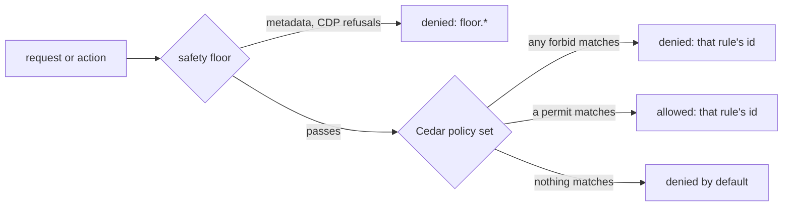

# Policy

AgentBrowser's operator decisions — approval outcomes, egress exceptions, capability grants —
live behind one seam ([ADR-024](adr/024-server-policy-engine-cedar.md)). Without configuration
they come from today's environment variables; with a **policy file** they come from a Cedar
policy document you control. [TD-BROWSER-15](td/TD-BROWSER-15-server-policy-engine.md) is the
implementation plan.

## Start here: the secure starter policy

An opinionated, deny-leaning policy file ships with the repository:
[`examples/policy/secure-starter.json`](https://github.com/anvai-labs/agentbrowser/blob/develop/examples/policy/secure-starter.json).
Copy it, then loosen it deliberately for each tenant.

```sh
cp examples/policy/secure-starter.json /etc/agentbrowser/policy.json
AGENTBROWSER_POLICY_FILE=/etc/agentbrowser/policy.json agentbrowser-server
agentbrowser policy-check request 10.1.2.3    # confirm: denied by operator.no-private
```

### How a decision is made



- **The floor comes first** and no policy can grant past it.
- **`forbid` beats `permit`.** Cedar denies whenever any `forbid` matches, whatever else permits.
  That is why the starter's guard rails are explicit `forbid` rules: a later, broader `permit`
  cannot quietly undo them.
- **Nothing matched means denied.** The starter still names every decision, so
  `rulesMatched`, the audit log and `policy-check` report *why*: for example
  `operator.capability.no-downloads`.

### What the starter decides, and why

| Area | Decision | Rule id | Why |
| --- | --- | --- | --- |
| Public web | allowed | `operator.public-egress` | Browsing is the product. The floor still blocks metadata addresses. |
| Loopback (`127.0.0.1`, `::1`, `localhost`) | **denied** | `operator.no-loopback` | A page could reach the service itself or local admin ports (SSRF). |
| Private networks (`10/8`, `192.168/16`, …) | **denied** | `operator.no-private` | A hostile page could pivot into your LAN or VPC. |
| Actions that read or write only locally | allowed, unattended | `operator.act.low-risk` | Navigation, typing and reading are the normal loop. |
| Transaction, account-security, external-message, destructive | **owner approval** | `operator.act.high-risk-*` | Money, credentials, messages and deletions need a human. |
| Unclassified actions (`unknown`) | **owner approval** | same rules + `unknownRisk: required` | If the effect can't be classified, it is treated as high risk. |
| Headed sessions | allowed | `operator.capability.headed` | A visible window on the server host adds no new reach. |
| Seeding cookies into a session | allowed | `operator.capability.cookie-seed` | The operator supplies them; it is the supported login path. |
| Exporting session cookies | **denied** | `operator.capability.no-cookie-export` | Credentials should never leave a session. |
| Cookie handoff from the operator browser | **denied** | `operator.capability.no-cookie-handoff` | Opt in per domain, never wholesale. |
| Service workers | **denied** | `operator.capability.no-service-workers` | Their requests bypass the egress choke point ([ADR-019](adr/019-explicit-service-worker-opt-in.md)). |
| Downloads | **denied** | `operator.capability.no-downloads` | Writes page-chosen bytes to the server's disk. |
| CDP attach to the operator browser | **denied** | `operator.capability.no-cdp-attach` | It shares the operator's real profile. |

### Loosening it, one tenant at a time

Each snippet is one entry in `policies`, with `ruleId` matching its `@rule`. Tenants exist only
when API keys are configured; without keys the only principal is `Tenant::"local"`. A permit
cannot override a matching starter `forbid`, so **narrow that forbid too**, as in the first
row's `unless` clause.

| Goal | Change |
| --- | --- |
| Let tenant `qa` download files | `forbid … "downloads" … unless { principal in AgentBrowser::Tenant::"qa" }` plus `permit(principal, action == AgentBrowser::Action::"downloads", resource) when { principal in AgentBrowser::Tenant::"qa" }` |
| Let tenant `qa` test a local app | narrow `operator.no-loopback` the same way and add a `request.loopback` permit for `qa` |
| Reach one internal subnet | `permit(principal, action == AgentBrowser::Action::"request.private", resource) when { context has ip && context.ip.isInRange(ip("10.20.0.0/16")) }`, with `operator.no-private` narrowed by the same condition |
| Allow cookie handoff for one site | `operator.no-cookie-handoff` narrowed with `unless { context.domain == "example.com" }`, plus a matching permit |

### Verify before and after every change

| Check | Command |
| --- | --- |
| A specific request | `agentbrowser policy-check request <host-or-ip>` |
| The loaded policy and per-capability decisions | `GET /v1/policy` (or the read-only `policy` MCP tool) |
| The file loads | start the server: any invalid document, unknown rule namespace or failed strict Cedar validation **refuses startup** |

The starter is pinned by `packages/policy-engine/src/secure-starter.test.ts`. That test loads the
file through the real loader, asserts every decision in the table above, and proves the
downloads and internal-subnet recipes work as written.

## The policy file

Set `AGENTBROWSER_POLICY_FILE=/path/to/policy.json` and the server loads the document at startup
and never reads the policy-bearing environment variables again — combining the two is a startup
refusal that names every conflict. The document carries:

- `version` — `agentbrowser-policy/v1`.
- `baseline` — `agentbrowser:baseline/v1` for a generated document, or `none` for a fully
  hand-written one (the server then warns that no public-egress permit exists — advisory only,
  since the floor permits public egress by default).
- `unknownRisk` — `allow` (default) or `required`, for actions whose effect cannot be classified.
- `approvalRules` — the approval rules, exactly as `AGENTBROWSER_APPROVAL_POLICY` accepts them.
- `policies` — the Cedar policy set: `{key, ruleId, cedar}` entries.
- `limits` — `extractMaxBytes` and `maxResponseBytes`, replacing the embedder options.

Every startup refusal is loud, never a silent ignore: an invalid document, an unknown `limits`
key, a `Tenant` literal other than `local` while no API keys are configured (found anywhere in
any policy, conditions included), a key tenant named `local` (reserved), or any policy Cedar's
strict validation refuses.

### Migrating: `policy export`

```sh
agentbrowser-server policy export > policy.json
```

writes the document for **today's environment configuration** — loopback, CIDR exceptions,
approval policy — parsed exactly as the service parses it. Operators migrate by generating, not
hand-writing. Invalid configuration fails with the same startup messages.

## The Cedar schema

The schema is the versioned contract `CEDAR_SCHEMA` (`agentbrowser-cedar/v1`) in
`@agentbrowser/protocol`. Its actions are the decision seam's actions:

- `request` — reserved in the schema for public-egress rules. Nothing evaluates it today:
  public egress is what the floor already allows (it blocks loopback, private and metadata
  addresses and permits the rest), so no permit is needed to browse.
- `request.loopback`, `request.private` — the **exception actions**: the only way an operator can
  let traffic reach loopback or private addresses. They carry `phase`, `target`,
  `addressClasses` (a **set**: an address can be `loopback` and `private` at once, `::1` is), and
  for `request.private` one normalized `ip` — the server asks once per private source (the
  address as written and each private IPv4 it embeds) and **every** source must be covered.
- `act`, `act.unattended` — whether a classified action may run, and whether it may run
  unattended. They carry `effect`, `matchedRule` (the first matching approval rule's id, or
  `rule-<index>`, or `none`), and optional `tenantId`, `hostname`, `action`, `role`, `name`.
- The capabilities — `cdp.attach`, `downloads`, `serviceWorkers`, `cookie.seed`,
  `cookie.export`, `session.headed` — carrying `tenantId`.

Entities: `Tenant`; `Session in [Tenant]`; `Host`. The session's parent is the deciding tenant —
with API keys, the caller's **authenticated** tenant; without keys, the implicit
`Tenant::"local"` whatever a caller claims. A caller-supplied `tenantId` in a policy-check
request never overrides it.

### The per-tenant pattern

```cedar
@rule("operator.loopback-qa")
permit(
  principal,
  action == AgentBrowser::Action::"request.loopback",
  resource
)
when { principal in AgentBrowser::Tenant::"qa" };
```

Only authenticated tenants exist as principals — that is the keys-only rule: without API keys
only `Tenant::"local"` exists, and the loader refuses a document naming any other tenant.

### `@rule`, `@internal` (`@reason` reserved)

Every policy carries a `@rule("<id>")` annotation that must match the document's `ruleId` — it is
the id reported in decisions, audit and `rulesMatched`. `floor.*`, `default.*` and `engine.*` are
reserved namespaces; `env.*` requires a baseline, so it is reserved for generated documents by
convention (a hand-written document that sets a baseline can technically carry one — don't).
`@internal` marks a policy whose deciding id stays confidential: the decision stands, but it
reports as `operator.policy` with no reason. `@reason` is reserved for per-decision reason text
and is not read yet.

## `policy check`

```sh
agentbrowser policy-check request example.com
agentbrowser policy-check request 10.1.2.3
```

or `POST /v1/policy/check`, or the read-only `policy` MCP tool, or the SDK's
`client.policyCheck()`. Answers come by **enumeration, never DNS resolution**: an IP literal is
classified and answered exactly as enforcement would answer it; a hostname passes the name-level
rules (metadata names are floor-denied; `localhost` answers by name) and then gets one answer per
class set — the public set is decided, and the loopback/private sets honestly answer
*depends on the resolved address*. `GET /v1/policy` summarizes the loaded policy — version,
limits, and one decision per capability "for a default session of the caller's tenant". Both
routes are rate-limited per tenant.

## Shadow mode

`AGENTBROWSER_POLICY_SHADOW=1` (without a file) evaluates the document this environment would
generate alongside the legacy decisions: **legacy decides**, divergences are logged at `warn`
with both rule ids, and a failure in the shadow never affects the decisions. Use it to preview a
migration. `/health` reports the authorizer's health as a boolean only.

## The floor

The safety floor is not policy and cannot be granted away by any document:

- cloud metadata endpoints are blocked, including every embedded form of their addresses
  (`floor.metadata`);
- the fixed Cephalon refusals — CDP attach admission, delegated-operator and operator-only
  routes — carry their own `floor.*` rule ids (`floor.cdp.*`, `floor.delegated.operator`);
- a spend-exhausted engagement scope denies under its own scope ids.

One statement to internalize: **browser traffic is not DNS-pinned**. The floor and the exception
actions are evaluated against the addresses the engine resolves and connects to; a hostname that
resolves differently between the check and the connect is caught by the per-request choke point,
not by a name-to-address promise.

The deprecated environment variables (`AGENTBROWSER_ALLOW_LOOPBACK`, `AGENTBROWSER_ALLOWED_CIDRS`,
`AGENTBROWSER_APPROVAL_POLICY`, `AGENTBROWSER_MAX_RESPONSE_BYTES`) still work and warn; the
[operations reference](operations.md#configuration) classifies every variable.
