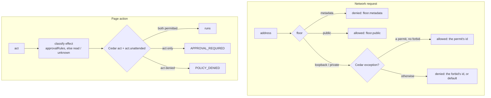

# Policy

AgentBrowser's operator decisions — approval outcomes, egress exceptions, capability grants —
live behind one seam ([ADR-024](adr/024-server-policy-engine-cedar.md)). Without configuration
they come from today's environment variables; with a **policy file** they come from a Cedar
policy document you control. [TD-BROWSER-15](td/TD-BROWSER-15-server-policy-engine.md) is the
implementation plan.

## Start here: the secure starter policy

An opinionated, deny-leaning policy file ships with the repository:
[`examples/policy/secure-starter.json`](https://github.com/anvai-labs/agentbrowser/blob/develop/examples/policy/secure-starter.json).
Copy it, then loosen it deliberately for each tenant.

```sh
cp examples/policy/secure-starter.json /etc/agentbrowser/policy.json
AGENTBROWSER_POLICY_FILE=/etc/agentbrowser/policy.json agentbrowser-server
agentbrowser policy-check request 10.1.2.3    # denied by operator.no-private
```

### How decisions are made



| Rule of the engine | Consequence |
| --- | --- |
| The floor decides public traffic and blocks metadata | no policy can grant past it; Cedar only grants *exceptions* |
| Any matching `forbid` wins | the starter's guard rails are explicit forbids, so a broader permit cannot undo them |
| Nothing matched means denied | the starter still names its decisions, so `rulesMatched`, audit and `policy-check` say *why* |
| Effects come from your `approvalRules`, never from page text | clicks, typing and key presses are `unknown` unless a rule classifies the control |

### What the starter decides, and why

| Area | Decision | Rule id | Why |
| --- | --- | --- | --- |
| Public web | allowed | `floor.public` | Browsing is the product. `operator.public-egress` only marks the intent (`request` is not evaluated) and keeps startup from warning. |
| Loopback (`127.0.0.1`, `::1`, `localhost`) | **denied** | `operator.no-loopback` | A page could reach the service itself or local admin ports (SSRF). |
| Private networks (`10/8`, `192.168/16`, …) | **denied** | `operator.no-private` | A hostile page could pivot into your LAN or VPC. |
| Reads, local writes, unclassified actions (click, type, press) | allowed | `operator.act.low-risk` | The normal agent loop; nothing can classify page controls generically. |
| Actions your `approvalRules` classify as transaction, account-security, external-message or destructive | **owner approval** | `operator.act.high-risk-*` | Money, credentials, messages and deletions need a human. |
| Headed sessions | allowed | `operator.capability.headed` | A visible window on the server host adds no new reach. |
| Seeding cookies into a session | allowed | `operator.capability.cookie-seed` | The operator supplies them; it is the supported login path. |
| Exporting session cookies | **denied** | `operator.capability.no-cookie-export` | Credentials should never leave a session. |
| Cookie handoff from the operator browser | **denied** | `operator.capability.no-cookie-handoff` | Opt in per domain, never wholesale. |
| Service workers | **denied** | `operator.capability.no-service-workers` | Their requests bypass the egress choke point ([ADR-019](adr/019-explicit-service-worker-opt-in.md)). |
| Downloads | **denied** | `operator.capability.no-downloads` | Writes page-chosen bytes to the server's disk. |
| CDP attach to the operator browser | **denied** | `operator.capability.no-cdp-attach` | It shares the operator's real profile (the floor refuses it first). |

`unknownRisk` has no effect with a policy file; the Cedar rules decide `unknown`.

### Classify your risky controls

Approval only engages once a rule says what a control *is*. Add one entry per control to
`approvalRules`. Matching is exact on `hostname`, `action`, `role` and `name`, and the first
matching rule wins:

```json
{ "id": "shop-place-order", "hostname": "shop.example.com", "name": "Place order", "effect": "transaction" }
```

That click now needs owner approval, while every other click on the site runs. This is pinned
by `packages/api/src/policy-file-approval-rules.test.ts`.

| Rule field | In a policy file |
| --- | --- |
| `effect` | classifies the control; the starter's high-risk rules then require approval |
| `decision` (`allow` / `required` / `deny`) | acts **only** through a policy keyed on `context.matchedRule == "<id>"`; a decision no policy reads **refuses startup** rather than being ignored |
| `id` | must be valid and unique (startup refuses otherwise); it becomes `context.matchedRule` |

### Loosening it, one tenant at a time

| Step | What to do |
| --- | --- |
| 1 | Narrow the starter's `forbid` with `unless { … }`. A permit alone cannot beat a matching forbid. |
| 2 | Add a `permit` with the same condition. Each entry needs a `ruleId` that matches its `@rule`. |
| Tenants | exist only with API keys. Without keys the deciding tenant is `Tenant::"local"`, the parent of every session. |

| Goal | Narrowed forbid + permit condition |
| --- | --- |
| Tenant `qa` may download files | `principal in AgentBrowser::Tenant::"qa"` on `downloads` |
| Tenant `qa` may test a local app | `principal in AgentBrowser::Tenant::"qa"` on `request.loopback` |
| Everyone may reach one internal subnet | `context has ip && context.ip.isInRange(ip("10.20.0.0/16"))` on `request.private` (add a tenant clause to scope it) |
| Cookie handoff for one site | `context.domain == "example.com"` on `cookie.handoff` |

### Verify before and after every change

| Check | Command |
| --- | --- |
| A specific request | `agentbrowser policy-check request <host-or-ip>` |
| The loaded policy and per-capability decisions | `GET /v1/policy` (or the read-only `policy` MCP tool) |
| The file loads | start the server: an invalid document, a reserved rule namespace or failed strict Cedar validation **refuses startup** |
| The starter's decisions and recipes | `packages/policy-engine/src/secure-starter.test.ts` (it also proves the downloads and subnet recipes) |

## The policy file

Set `AGENTBROWSER_POLICY_FILE=/path/to/policy.json` and the server loads the document at startup
and never reads the policy-bearing environment variables again — combining the two is a startup
refusal that names every conflict. The document carries:

- `version` — `agentbrowser-policy/v1`.
- `baseline` — `agentbrowser:baseline/v1` for a generated document, or `none` for a fully
  hand-written one (the server then warns that no public-egress permit exists — advisory only,
  since the floor permits public egress by default).
- `unknownRisk` — `allow` (default) or `required`. Kept for the export round trip; with a file the
  Cedar rules decide `unknown` actions.
- `approvalRules` — the approval rules, exactly as `AGENTBROWSER_APPROVAL_POLICY` accepts them;
  they classify each action's effect before Cedar decides.
- `policies` — the Cedar policy set: `{key, ruleId, cedar}` entries.
- `limits` — `extractMaxBytes` and `maxResponseBytes`, replacing the embedder options.

Every startup refusal is loud, never a silent ignore: an invalid document, an unknown `limits`
key, a `Tenant` literal other than `local` while no API keys are configured (found anywhere in
any policy, conditions included), a key tenant named `local` (reserved), or any policy Cedar's
strict validation refuses.

### Migrating: `policy export`

```sh
agentbrowser-server policy export > policy.json
```

writes the document for **today's environment configuration** — loopback, CIDR exceptions,
approval policy — parsed exactly as the service parses it. Operators migrate by generating, not
hand-writing. Invalid configuration fails with the same startup messages.

> **The export does not carry `limits`.** `AGENTBROWSER_MAX_RESPONSE_BYTES` (and the embedder
> budget options) map to the document's `limits` object, which `policy export` does not emit —
> add them by hand after generating, or the file's defaults (including the 10 MB response cap)
> apply.

### Worked example: retiring the deprecated env vars (Homebrew deployment)

The scenario this exists for: a brew upgrade regenerates the launchd plist, silently dropping
every custom `AGENTBROWSER_*` override except the ones the formula itself sets. A policy file
under `/opt/homebrew/etc` survives upgrades untouched; only the one
`AGENTBROWSER_POLICY_FILE` pointer needs to survive in the plist.

Say today's deprecated configuration is:

```sh
AGENTBROWSER_ALLOW_LOOPBACK=1                       # loopback block disabled server-wide
AGENTBROWSER_ALLOWED_CIDRS=192.168.1.0/24,10.8.0.0/16  # private-range exceptions
AGENTBROWSER_MAX_RESPONSE_BYTES=33554432               # 32 MB response cap
```

**1. Generate and complete the document** (run with the old env still set, so the export sees
it):

```sh
mkdir -p "$(brew --prefix)/etc/agentbrowser"
AGENTBROWSER_ALLOW_LOOPBACK=1 \
AGENTBROWSER_ALLOWED_CIDRS=192.168.1.0/24,10.8.0.0/16 \
AGENTBROWSER_MAX_RESPONSE_BYTES=33554432 \
  agentbrowser-server policy export \
  > "$(brew --prefix)/etc/agentbrowser/policy.json"
```

Then edit the file: add the `limits` object the export omits, and — strongly recommended —
replace the export's blanket `env.allow-loopback` permit with a scoped rule so loopback reaches
only the hosts that actually need it (the floor's `forbid` stays in effect for everything else):

```json
{
  "version": "agentbrowser-policy/v1",
  "baseline": "agentbrowser:baseline/v1",
  "unknownRisk": "allow",
  "approvalRules": [],
  "limits": { "maxResponseBytes": 33554432 },
  "policies": [
    {
      "key": "operator.loopback-local-dev#1",
      "ruleId": "operator.loopback-local-dev",
      "cedar": "@rule(\"operator.loopback-local-dev\") permit(principal, action == AgentBrowser::Action::\"request.loopback\", resource) when { principal in AgentBrowser::Tenant::\"local\" };"
    },
    {
      "key": "env.allowed-cidrs#2",
      "ruleId": "env.allowed-cidrs",
      "cedar": "@rule(\"env.allowed-cidrs\") permit(principal, action == AgentBrowser::Action::\"request.private\", resource) when { context has ip && (context.ip.isInRange(ip(\"192.168.1.0/24\")) || context.ip.isInRange(ip(\"10.8.0.0/16\"))) };"
    },
    {
      "key": "env.block-private#3",
      "ruleId": "env.block-private",
      "cedar": "@rule(\"env.block-private\") forbid(principal, action == AgentBrowser::Action::\"request.private\", resource) unless { context has ip && (context.ip.isInRange(ip(\"192.168.1.0/24\")) || context.ip.isInRange(ip(\"10.8.0.0/16\"))) };"
    },
    {
      "key": "env.capability.default#4",
      "ruleId": "env.capability.default",
      "cedar": "@rule(\"env.capability.default\") permit(principal, action in [AgentBrowser::Action::\"cdp.attach\", AgentBrowser::Action::\"downloads\", AgentBrowser::Action::\"serviceWorkers\", AgentBrowser::Action::\"cookie.seed\", AgentBrowser::Action::\"cookie.export\", AgentBrowser::Action::\"session.headed\", AgentBrowser::Action::\"cookie.handoff\"], resource);"
    }
  ]
}
```

(Keep the `env.approval.*` rules the export emitted if you use approval classification; they are
omitted here only for brevity. Without API keys only `Tenant::"local"` may appear — see the
per-tenant pattern above for the keyed form.)

**2. Validate before switching** — `policy check` (or shadow mode, below) confirms the document
decides what you expect while the legacy env still governs.

**3. Point the service at it and drop the deprecated vars.** On Homebrew, `brew services`
regenerates the launchd plist from the formula on every start — hand-editing the plist does not
survive that. Two durable mechanisms, both outside the plist:

- Since the tap's formula revision accompanying 1.27.3, the service stanza itself sets
  `AGENTBROWSER_POLICY_FILE=$(brew --prefix)/etc/agentbrowser/policy.json` and the install
  writes a default document there once (never clobbered) — nothing to configure.
- Non-policy env (API keys, operator-key path, login browser) belongs in brew's native
  user-override file, which `brew services` re-applies to every generated plist:
  `~/.homebrew/services/agentbrowser.env` (`KEY=value` lines; see `brew services --help`).

Note the combination rule: `AGENTBROWSER_POLICY_FILE` together with any policy-bearing
variable is a **startup refusal**, so a stale `AGENTBROWSER_MAX_RESPONSE_BYTES` or
`ALLOWED_CIDRS` line left in the override file fails loudly rather than half-applying —
remove the policy-bearing entries when you adopt the file.

```sh
# Remove policy-bearing lines from the override file, keep secrets:
grep -v '^AGENTBROWSER_\(MAX_RESPONSE_BYTES\|ALLOW_LOOPBACK\|ALLOWED_CIDRS\|APPROVAL_POLICY\)=' \
  ~/.homebrew/services/agentbrowser.env > /tmp/ab.env && mv /tmp/ab.env ~/.homebrew/services/agentbrowser.env
brew services restart agentbrowser
```

Check the startup banner (it prints the loaded policy version) and `agentbrowser policy` for the
active summary — with a file loaded it prints the document hash. Restart the service again to
confirm the configuration survives regeneration; upgrades never touch any of it.

## The Cedar schema

The schema is the versioned contract `CEDAR_SCHEMA` (`agentbrowser-cedar/v1`) in
`@agentbrowser/protocol`. Its actions are the decision seam's actions:

- `request` — reserved in the schema for public-egress rules. Nothing evaluates it today:
  public egress is what the floor already allows (it blocks loopback, private and metadata
  addresses and permits the rest), so no permit is needed to browse.
- `request.loopback`, `request.private` — the **exception actions**: the only way an operator can
  let traffic reach loopback or private addresses. They carry `phase`, `target`,
  `addressClasses` (a **set**: an address can be `loopback` and `private` at once, `::1` is), and
  for `request.private` one normalized `ip` — the server asks once per private source (the
  address as written and each private IPv4 it embeds) and **every** source must be covered.
- `act`, `act.unattended` — whether a classified action may run, and whether it may run
  unattended. They carry `effect`, `matchedRule` (the first matching approval rule's id, or
  `rule-<index>`, or `none`), and optional `tenantId`, `hostname`, `action`, `role`, `name`.
- The capabilities — `cdp.attach`, `downloads`, `serviceWorkers`, `cookie.seed`,
  `cookie.export`, `session.headed` — carrying `tenantId`.

Entities: `Tenant`; `Session in [Tenant]`; `Host`. The session's parent is the deciding tenant —
with API keys, the caller's **authenticated** tenant; without keys, the implicit
`Tenant::"local"` whatever a caller claims. A caller-supplied `tenantId` in a policy-check
request never overrides it.

### The per-tenant pattern

```cedar
@rule("operator.loopback-qa")
permit(
  principal,
  action == AgentBrowser::Action::"request.loopback",
  resource
)
when { principal in AgentBrowser::Tenant::"qa" };
```

Only authenticated tenants exist as principals — that is the keys-only rule: without API keys
only `Tenant::"local"` exists, and the loader refuses a document naming any other tenant.

### `@rule`, `@internal` (`@reason` reserved)

Every policy carries a `@rule("<id>")` annotation that must match the document's `ruleId` — it is
the id reported in decisions, audit and `rulesMatched`. `floor.*`, `default.*` and `engine.*` are
reserved namespaces; `env.*` requires a baseline, so it is reserved for generated documents by
convention (a hand-written document that sets a baseline can technically carry one — don't).
`@internal` marks a policy whose deciding id stays confidential: the decision stands, but it
reports as `operator.policy` with no reason. `@reason` is reserved for per-decision reason text
and is not read yet.

## `policy check`

```sh
agentbrowser policy-check request example.com
agentbrowser policy-check request 10.1.2.3
```

or `POST /v1/policy/check`, or the read-only `policy` MCP tool, or the SDK's
`client.policyCheck()`. Answers come by **enumeration, never DNS resolution**: an IP literal is
classified and answered exactly as enforcement would answer it; a hostname passes the name-level
rules (metadata names are floor-denied; `localhost` answers by name) and then gets one answer per
class set — the public set is decided, and the loopback/private sets honestly answer
*depends on the resolved address*. `GET /v1/policy` summarizes the loaded policy — version,
limits, and one decision per capability "for a default session of the caller's tenant". Both
routes are rate-limited per tenant.

## Shadow mode

`AGENTBROWSER_POLICY_SHADOW=1` (without a file) evaluates the document this environment would
generate alongside the legacy decisions: **legacy decides**, divergences are logged at `warn`
with both rule ids, and a failure in the shadow never affects the decisions. Use it to preview a
migration. `/health` reports the authorizer's health as a boolean only.

## The floor

The safety floor is not policy and cannot be granted away by any document:

- cloud metadata endpoints are blocked, including every embedded form of their addresses
  (`floor.metadata`);
- the fixed Cephalon refusals — CDP attach admission, delegated-operator and operator-only
  routes — carry their own `floor.*` rule ids (`floor.cdp.*`, `floor.delegated.operator`);
- a spend-exhausted engagement scope denies under its own scope ids.

One statement to internalize: **browser traffic is not DNS-pinned**. The floor and the exception
actions are evaluated against the addresses the engine resolves and connects to; a hostname that
resolves differently between the check and the connect is caught by the per-request choke point,
not by a name-to-address promise.

The deprecated environment variables (`AGENTBROWSER_ALLOW_LOOPBACK`, `AGENTBROWSER_ALLOWED_CIDRS`,
`AGENTBROWSER_APPROVAL_POLICY`, `AGENTBROWSER_MAX_RESPONSE_BYTES`) still work and warn; the
[operations reference](operations.md#configuration) classifies every variable.
